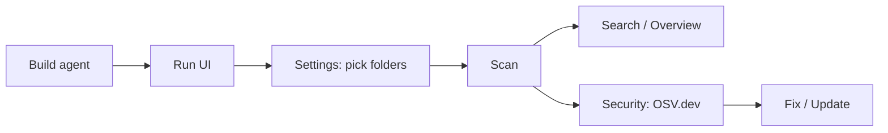
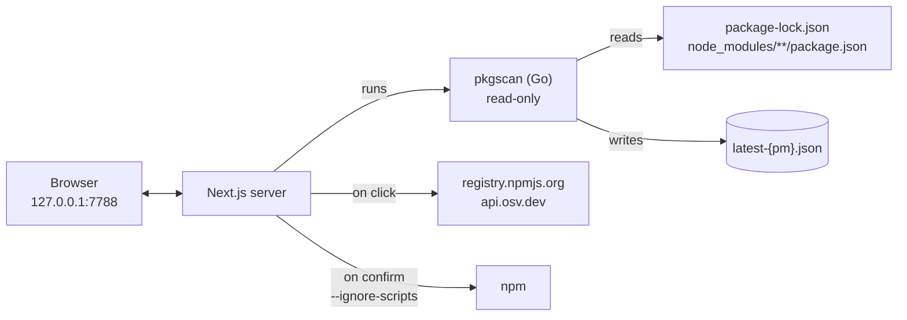

# LIBPACK Guard

**English** · [Tiếng Việt](README.vi.md) · [简体中文](README.zh-CN.md)

Inventory and protect the **npm** packages on your machine: see instantly which package is installed where, which ones are **malicious**, **vulnerable** or **outdated**, then update them safely right from the UI.

Everything runs **locally** (`127.0.0.1`) — no account, no server. The network is used only when you click a check.

## Features

- 🔍 **Instant lookup:** *"Is `axios@1.7.4` on this machine, and in which project?"*
- 🛡️ **Security:**
  - checks [OSV.dev](https://osv.dev) for **malicious** packages (OpenSSF `MAL-*`, GitHub CWE-506) and **vulnerabilities** (GHSA/CVE);
  - analyses **suspicious install scripts** (`preinstall` / `postinstall`) offline.
- ⬆️ **Updates:**
  - plans updates across all projects, patch/minor only by default;
  - update one package with a single click (confirmation + backup), or download a `.ps1` / `.sh` script to run yourself.
- 🩹 **One-click vulnerability fix:** the server picks the right fix (install the fixed version, `npm update`, or update the parent package), then rescans to verify.
- 📦 **npm and pnpm, kept apart:** pick **npm** or **pnpm** in the top bar. Scanning, search, security checks and updates only cover the selected one, each with its own data files (`latest-npm.json` / `latest-pnpm.json`), and only that package manager is ever run. pnpm projects are read from `node_modules/.pnpm` (orphaned old versions are ignored), including pnpm global installs.
- 🗑️ **Uninstall:** remove a direct dependency or a top-level global package (e.g. a malicious one) from the UI, with confirmation, backup and an automatic rescan.
- 🗂️ **Choose the folders to scan in the UI**, with a built-in folder browser.
- 🌐 **Tiếng Việt / English / 简体中文**, **Light / Dark / System** theme.

## Quick start

**Requirements:** Go ≥ 1.23 and Node.js ≥ 20.

```powershell
git clone <url>/libpack-guard.git
cd libpack-guard

# 1. Build the pkgscan agent
cd agent
.\build.ps1            # macOS / Linux: ./build.sh

# 2. Run the UI
cd ..\ui
npm install
npm run build
npm run start          # open http://127.0.0.1:7788
```

Then: **Settings** → add the folders that contain your projects → **Save & scan now** → look at **Overview**. Go to **Security** and click **Check with OSV.dev**.



## How it works



| Component | Role |
|---|---|
| `agent/` — **pkgscan** | Go, standard library only, a single binary. **Reads only** lockfiles and `package.json` files; never runs npm, node or a shell. |
| `ui/` — **web UI** | Next.js, no database. Search, security checks, update planning and updates. |

## Safety

- `pkgscan` **cannot** start processes: a test forbids importing `os/exec` / `syscall`. It does not follow symlinks/junctions and skips files over 50 MB.
- npm runs **only after you confirm**, always with `--ignore-scripts` and without a shell. The server builds the command itself, and the project is backed up first.
- The target version is checked against OSV before installing. If it is flagged as malware, or the check cannot be done, nothing runs.
- OSV lookups send only package **names and versions**, never paths or machine details.
- The server listens on `127.0.0.1` only and rejects requests from other websites.

Details: [docs/security.md](docs/en/security.md).

## Documentation

| Document | Contents |
|---|---|
| [Workflows](docs/en/workflows.md) | Screens; scanning, version checks, security checks, fixing, updating, i18n (with diagrams) |
| [Architecture](docs/en/architecture.md) | Overall diagram, source layout, `latest-{pm}.json` / `security-{pm}.json` / `config.json` formats, environment variables |
| [Security model](docs/en/security.md) | Permissions per component, guardrails when running npm, risks and mitigations |
| [API & CLI](docs/en/api.md) | Internal UI API, `pkgscan scan / find` commands |
| [Development](docs/en/development.md) | Build, tests, adding a language, troubleshooting, known limitations |

## Main limitations

- **npm** and **pnpm** only (no yarn or bun yet).
- Detects only malware that **has been reported**. Install-script analysis gives signals, not verdicts.
- The app runs **on each machine**, so it cannot be put on the cloud as is.

Full list: [Known limitations](docs/en/development.md#known-limitations).
