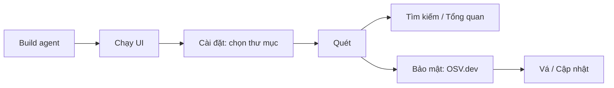
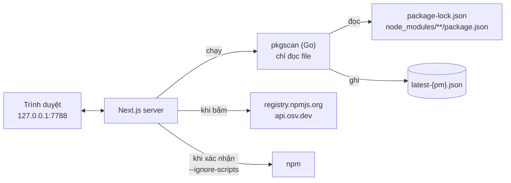

# LIBPACK Guard

[English](README.md) · **Tiếng Việt** · [简体中文](README.zh-CN.md)

Kiểm kê và bảo vệ package **npm** trên máy của bạn: biết ngay package nào đang được cài ở đâu, package nào **độc hại**, **có lỗ hổng** hay **đã cũ**, rồi cập nhật an toàn ngay trên giao diện.

Mọi thứ chạy **cục bộ** (`127.0.0.1`), không cần tài khoản và không cần máy chủ. Mạng chỉ được dùng khi bạn bấm kiểm tra.

## Tính năng

- 🔍 **Tìm kiếm tức thì:** *"Máy này có `axios@1.7.4` không, nằm ở dự án nào?"*
- 🛡️ **Bảo mật:**
  - đối chiếu [OSV.dev](https://osv.dev) để phát hiện package **độc hại** (OpenSSF `MAL-*`, GitHub CWE-506) và **lỗ hổng** (GHSA/CVE);
  - phân tích offline các **script cài đặt đáng ngờ** (`preinstall` / `postinstall`).
- ⬆️ **Cập nhật:**
  - lập kế hoạch cho mọi dự án, mặc định chỉ nâng patch/minor;
  - cập nhật từng package bằng một nút bấm (có xác nhận và sao lưu), hoặc tải script `.ps1` / `.sh` để tự chạy.
- 🩹 **Vá lỗ hổng một chạm:** server tự chọn cách vá đúng (cài bản vá, `npm update`, hay cập nhật package cha), rồi quét lại để xác nhận.
- 📦 **npm và pnpm tách riêng:** chọn **npm** hoặc **pnpm** ở thanh trên cùng. Quét, tìm kiếm, kiểm tra bảo mật và cập nhật chỉ làm trên phần đang chọn, mỗi phần có file dữ liệu riêng (`latest-npm.json` / `latest-pnpm.json`) và chỉ chạy đúng trình quản lý package đó. Dự án pnpm được đọc từ `node_modules/.pnpm` (bỏ qua bản cũ mồ côi), có cả package global của pnpm.
- 🗑️ **Gỡ bỏ:** gỡ package trực tiếp hoặc package global cấp trên cùng (ví dụ package độc hại) ngay trên giao diện, có xác nhận, sao lưu và tự quét lại.
- 🗂️ **Chọn thư mục quét ngay trên giao diện**, kèm bộ duyệt thư mục.
- 🌐 **Tiếng Việt / English / 简体中文**, giao diện **Sáng / Tối / Theo hệ thống**.

## Bắt đầu nhanh

**Yêu cầu:** Go ≥ 1.23 và Node.js ≥ 20.

```powershell
git clone <url>/libpack-guard.git
cd libpack-guard

# 1. Build agent pkgscan
cd agent
.\build.ps1            # macOS / Linux: ./build.sh

# 2. Chạy giao diện
cd ..\ui
npm install
npm run build
npm run start          # mở http://127.0.0.1:7788
```

Sau đó: **Cài đặt** → thêm thư mục chứa dự án → **Lưu và quét ngay** → xem **Tổng quan**. Sang tab **Bảo mật** và bấm **Kiểm tra với OSV.dev**.



## Cách hoạt động



| Thành phần | Vai trò |
|---|---|
| `agent/` — **pkgscan** | Go, chỉ thư viện chuẩn, một file chạy duy nhất. **Chỉ đọc** lockfile và `package.json`; không bao giờ chạy npm, node hay shell. |
| `ui/` — **giao diện** | Next.js, không dùng cơ sở dữ liệu. Tìm kiếm, kiểm tra bảo mật, lập kế hoạch và thực hiện cập nhật. |

## An toàn

- `pkgscan` **không thể** chạy tiến trình: có test chặn import `os/exec` / `syscall`. Nó không đi theo symlink/junction và bỏ qua file > 50 MB.
- npm **chỉ chạy khi bạn bấm xác nhận**, luôn với `--ignore-scripts` và không qua shell. Lệnh do server tự tạo; dự án được sao lưu trước khi chạy.
- Phiên bản đích được kiểm tra với OSV trước khi cài. Có cảnh báo mã độc, hoặc không kiểm tra được, thì không chạy.
- Tra cứu OSV chỉ gửi **tên và phiên bản** package, không gửi đường dẫn hay thông tin máy.
- Server chỉ lắng nghe trên `127.0.0.1` và chặn request từ trang web khác.

Chi tiết: [docs/security.md](docs/vi/security.md).

## Tài liệu

| Tài liệu | Nội dung |
|---|---|
| [Workflow](docs/vi/workflows.md) | Các màn hình; quét, kiểm tra phiên bản, kiểm tra bảo mật, vá lỗ hổng, cập nhật, i18n (kèm sơ đồ) |
| [Kiến trúc](docs/vi/architecture.md) | Sơ đồ tổng thể, cấu trúc mã nguồn, định dạng `latest-{pm}.json` / `security-{pm}.json` / `config.json`, biến môi trường |
| [Mô hình an toàn](docs/vi/security.md) | Quyền hạn từng thành phần, các rào chắn khi chạy npm, rủi ro và biện pháp |
| [API và dòng lệnh](docs/vi/api.md) | API nội bộ của UI, lệnh `pkgscan scan / find` |
| [Phát triển](docs/vi/development.md) | Build, test, thêm ngôn ngữ, xử lý sự cố, giới hạn đã biết |

## Giới hạn chính

- Chỉ hỗ trợ **npm** và **pnpm** (chưa hỗ trợ yarn, bun).
- Chỉ phát hiện mã độc **đã được báo cáo**. Phân tích script cài đặt chỉ là dấu hiệu, không phải kết luận.
- Ứng dụng chạy **trên từng máy**, nên không đưa lên cloud nguyên trạng được.

Xem đầy đủ: [Giới hạn đã biết](docs/vi/development.md#giới-hạn-đã-biết).
