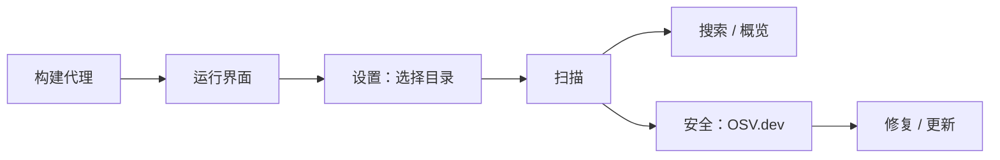
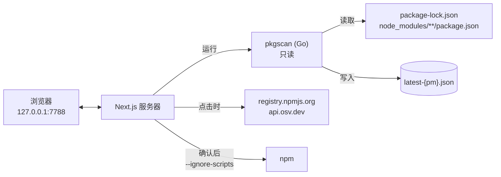

# LIBPACK Guard

[English](README.md) · [Tiếng Việt](README.vi.md) · **简体中文**

清点并保护你电脑上的 **npm** 包：立即知道每个包安装在哪里、哪些是**恶意包**、哪些**存在漏洞**或**已过期**，并直接在界面中安全地更新。

一切都在**本地**运行（`127.0.0.1`），无需账号，无需服务器。只有在你点击检查时才会联网。

## 功能

- 🔍 **即时查询：** *“这台机器上有 `axios@1.7.4` 吗？在哪个项目里？”*
- 🛡️ **安全：**
  - 对照 [OSV.dev](https://osv.dev) 检测**恶意包**（OpenSSF `MAL-*`、GitHub CWE-506）和**漏洞**（GHSA/CVE）；
  - 离线分析**可疑的安装脚本**（`preinstall` / `postinstall`）。
- ⬆️ **更新：**
  - 为所有项目制定更新计划，默认只升级补丁 / 次版本；
  - 一键更新单个包（需确认并自动备份），或下载 `.ps1` / `.sh` 脚本自行运行。
- 🩹 **一键修复漏洞：** 服务器会自动选择正确的修复方式（安装修复版本、`npm update` 或更新父包），然后重新扫描以确认结果。
- 📦 **npm 与 pnpm 完全分开：** 在顶部栏选择 **npm** 或 **pnpm**。扫描、搜索、安全检查和更新只针对当前选择的那个，各自使用独立的数据文件（`latest-npm.json` / `latest-pnpm.json`），且只运行对应的包管理器。pnpm 项目从 `node_modules/.pnpm` 读取（忽略遗留的旧版本），并包含 pnpm 全局包。
- 🗑️ **卸载：** 在界面中卸载直接依赖或顶层全局包（例如恶意包），需确认，自动备份并重新扫描。
- 🗂️ **在界面中选择扫描目录**，内置目录浏览器。
- 🌐 **Tiếng Việt / English / 简体中文**，**浅色 / 深色 / 跟随系统** 主题。

## 快速开始

**要求：** Go ≥ 1.23，Node.js ≥ 20。

```powershell
git clone <url>/libpack-guard.git
cd libpack-guard

# 1. 构建 pkgscan 代理
cd agent
.\build.ps1            # macOS / Linux: ./build.sh

# 2. 运行界面
cd ..\ui
npm install
npm run build
npm run start          # 打开 http://127.0.0.1:7788
```

然后：**设置** → 添加包含项目的目录 → **保存并立即扫描** → 查看 **概览**。进入 **安全** 页面，点击 **使用 OSV.dev 检查**。



## 工作原理



| 组件 | 作用 |
|---|---|
| `agent/` — **pkgscan** | Go，仅使用标准库，单个可执行文件。**只读取** lockfile 和 `package.json`；从不运行 npm、node 或 shell。 |
| `ui/` — **网页界面** | Next.js，无数据库。负责搜索、安全检查、更新计划和执行更新。 |

## 安全

- `pkgscan` **无法**启动任何进程：有测试禁止导入 `os/exec` / `syscall`。它不跟随符号链接 / junction，并跳过大于 50 MB 的文件。
- npm **只有在你确认后才会运行**，始终带 `--ignore-scripts` 且不经过 shell。命令由服务器自己生成，运行前会先备份项目。
- 安装前会用 OSV 检查目标版本。如果它被标记为恶意软件，或无法完成检查，则不会运行。
- 查询 OSV 时只发送包的**名称和版本**，从不发送路径或机器信息。
- 服务器只监听 `127.0.0.1`，并拒绝来自其他网站的请求。

详情：[docs/security.md](docs/zh-CN/security.md)。

## 文档

| 文档 | 内容 |
|---|---|
| [工作流程](docs/zh-CN/workflows.md) | 各个页面；扫描、版本检查、安全检查、修复、更新、多语言（含图示） |
| [架构](docs/zh-CN/architecture.md) | 整体架构图、源码结构、`latest-{pm}.json` / `security-{pm}.json` / `config.json` 格式、环境变量 |
| [安全模型](docs/zh-CN/security.md) | 各组件的权限、运行 npm 时的防护措施、风险与对策 |
| [API 与命令行](docs/zh-CN/api.md) | 界面内部 API、`pkgscan scan / find` 命令 |
| [开发](docs/zh-CN/development.md) | 构建、测试、添加语言、故障排查、已知限制 |

## 主要限制

- 仅支持 **npm** 和 **pnpm**（暂不支持 yarn、bun）。
- 只能检测**已被报告**的恶意包。安装脚本分析只给出迹象，并非结论。
- 应用运行**在每台机器上**，因此无法原样部署到云端。

完整列表：[已知限制](docs/zh-CN/development.md#已知限制)。
