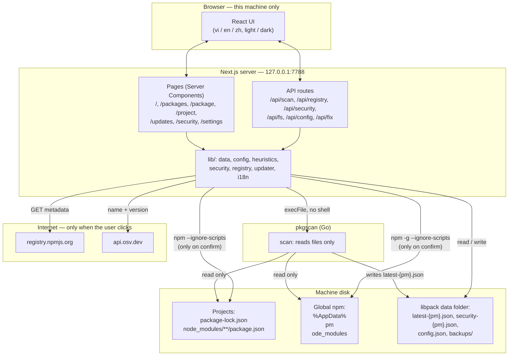

# Architecture

> Detailed documentation for **LIBPACK**. Overview: [README](../../README.md) · [Tiếng Việt](../vi/architecture.md) · [简体中文](../zh-CN/architecture.md).

## Overview



**Design principles**

- **Separation of privileges.** `pkgscan` only reads files, so it can run anywhere without risk. Every action that can change the machine (running npm) lives in the UI server, happens only when the user confirms, and always comes with guardrails (see [Security model](security.md)).
- **No database.** All state lives in a few JSON files in libpack's own data folder.
- **Offline first.** Scanning, searching and install-script analysis all run offline. The network is used only when you click a registry or OSV check, or when updating.
- **No extra dependencies.** The agent uses only the Go standard library. The UI uses only `next`, `react`, `react-dom` (plus `typescript` and `@types/*` for development); i18n, theming and semver are all hand-written.

## Source layout

```
libpack-guard/
├── README.md / README.vi.md / README.zh-CN.md   # overview (English / Tiếng Việt / 简体中文)
├── docs/
│   ├── en/  vi/  zh-CN/            # detailed documentation per language
│   └── <language>/{workflows, architecture, security, api, development}.md
├── .gitignore
├── agent/                          # pkgscan — Go, standard library only
│   ├── main.go                     # scan / find / version commands, writes latest-{pm}.json
│   ├── config.go                   # reads config.json (data folder → next to exe → defaults)
│   ├── datadir.go                  # per-OS data folder
│   ├── walk.go                     # safe walking: isPlainDir, 50 MB limit, skip list
│   ├── scan.go                     # walks the root folders, dedupe, machine info
│   ├── lockfile.go                 # package-lock v1 / v2 / v3, alias, direct, hasInstallScript
│   ├── nodemodules.go              # node_modules/<name>, @scope/<name>, nesting, install scripts
│   ├── global.go                   # global npm folder
│   ├── payload.go                  # Result / Package data types
│   ├── agent_test.go               # unit tests (see docs/development.md)
│   ├── testdata/                   # lockfile v1, v3, scoped, global, suspicious script
│   ├── build.ps1 / build.sh        # builds windows/amd64, darwin/arm64, darwin/amd64, linux/amd64
│   └── config.example.json
└── ui/                             # Next.js 16, TypeScript
    ├── .env.example
    └── src/
        ├── app/
        │   ├── layout.tsx          # header, nav, language / theme switchers, Inter font
        │   ├── globals.css         # light / dark design tokens, responsive
        │   ├── page.tsx            # Overview
        │   ├── packages/ package/ project/ updates/ security/ settings/
        │   ├── loading.tsx, icon.svg
        │   └── api/  scan/ registry/ security/ fs/ config/ fix/
        ├── components/
        │   ├── I18nProvider, Preferences, NavLinks, Brand
        │   ├── ScanButton, SecurityCheckButton, SecurityBanner
        │   ├── PackageCheck, ProjectTable, CopyText, registry-client
        │   ├── UpdatePlanner, UpgradeButton, FixButton
        │   └── FolderPicker, ScanSettings
        └── lib/
            ├── data.ts             # reads latest-{pm}.json (cached by mtime), aggregates projects
            ├── agent.ts            # runs pkgscan
            ├── config.ts           # reads / writes config.json, lists folders
            ├── heuristics.ts       # install-script analysis rules
            ├── security.ts         # OSV querybatch / query, malware classification, security-{pm}.json
            ├── registry.ts         # npm registry + bestCompatible
            ├── updater.ts          # planAction / planUpgrade / applyAction (runs npm)
            ├── update-script.ts    # builds commands and .ps1 / .sh scripts
            ├── semver.ts           # version comparison
            ├── http.ts             # sameOrigin + loopback Host check
            ├── i18n.ts             # vi / en / zh dictionaries, date and number formatting
            └── i18n-server.ts      # reads lang / theme cookies, Accept-Language
```

## Data and file formats

> `{pm}` is `npm` or `pnpm`. The two package managers are kept completely separate: each has its own scan file and security report, chosen with the npm / pnpm switch in the top bar (cookie `pm`).

### Data folder

| OS | Path |
|---|---|
| Windows | `%LOCALAPPDATA%\libpack\` |
| macOS | `~/Library/Application Support/libpack/` |
| Linux | `$XDG_DATA_HOME/libpack/` or `~/.local/share/libpack/` |

It can be overridden with the `LIBPACK_DATA_DIR` environment variable. Both pkgscan and the UI read it.

```
libpack/
├── latest-{pm}.json        # latest scan result (written by pkgscan)
├── security-{pm}.json      # latest OSV lookup result (written by the UI)
├── config.json        # scan folders + depth (written by the UI, read by pkgscan)
└── backups/
    └── 2026-11-07T06-43-41-007Z/
        └── C_Users_me_proj/
            ├── package.json
            └── package-lock.json
```

### `latest-{pm}.json`

```jsonc
{
  "machine": { "hostname": "PC-01", "os": "windows", "arch": "amd64", "username": "PC-01\\me" },
  "agent_version": "0.1.0",
  "scanned_at": "2026-11-07T04:38:26Z",
  "roots": ["C:\\Users\\me\\projects"],
  "packages": [
    {
      "ecosystem": "npm",
      "name": "@org/pkg",
      "version": "2.0.0",
      "scope": "project",                 // "project" | "global"
      "project_root": "C:\\Users\\me\\projects\\app",
      "source_file": "C:\\Users\\me\\projects\\app\\node_modules\\@org\\pkg\\package.json",
      "direct": true,                     // lockfile v2/v3: is a direct dependency
      "description": "…", "license": "MIT", "author": "Org",
      "homepage": "https://…", "repository": "https://github.com/org/pkg",
      "install_scripts": { "postinstall": "node install.js" },   // text only, never executed
      "has_install_script": true
    }
  ]
}
```

Records are deduplicated on **`name + version + project_root`**.

### `security-{pm}.json`

```jsonc
{
  "checked_at": "2026-11-07T05:09:49Z",
  "scan_at": "2026-11-07T04:38:26Z",       // differs from the current scanned_at → UI says a re-check is needed
  "queried": 1155,
  "advisories": [
    {
      "id": "GHSA-35jh-r3h4-6jhm",
      "kind": "vuln",                        // "malware" | "vuln"
      "severity": "high",                    // critical | high | moderate | low | unknown
      "summary": "Command Injection in lodash",
      "aliases": ["CVE-2021-23337"],
      "url": "https://osv.dev/vulnerability/GHSA-35jh-r3h4-6jhm",
      "hits": [{ "name": "lodash", "version": "4.17.15", "fixed": ["4.17.21"] }]
    }
  ],
  "errors": []
}
```

### `config.json`

```json
{ "roots": ["C:\\Users\\me\\projects", "D:\\work"], "max_depth": 8 }
```

If `roots` is empty, the default folders are used. When editing by hand, Windows paths must use `/` or `\\`.

### Environment variables (UI)

| Variable | Default | Meaning |
|---|---|---|
| `LIBPACK_DATA_DIR` | see [Data folder](#data-folder) | Data folder |
| `LIBPACK_AGENT_PATH` | `../agent/dist/pkgscan-<os>-<arch>[.exe]` | Path to the pkgscan binary |
| `NPM_REGISTRY_URL` | `https://registry.npmjs.org` | Registry used for version lookups |

See `ui/.env.example`.
