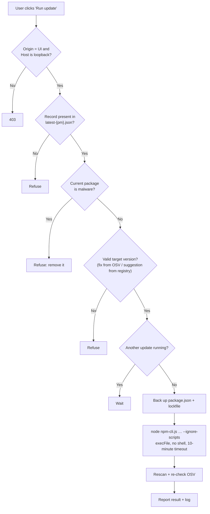

# Security model

> Detailed documentation for **LIBPACK**. Overview: [README](../../README.md) · [Tiếng Việt](../vi/security.md) · [简体中文](../zh-CN/security.md).

## Who can do what

| Component | Reads | Writes | Runs processes | Network |
|---|---|---|---|---|
| **pkgscan** | Only `package-lock.json` and `node_modules/**/package.json` | Only the libpack data folder | **Never** (a test forbids importing `os/exec`, `syscall`) | **None** |
| **UI server** | `latest-{pm}.json`, `security-{pm}.json`, `config.json`; subfolder names (folder browser) | `config.json`, `security-{pm}.json`, `backups/` | `pkgscan scan`; `npm` **only after the user confirms** | registry.npmjs.org, api.osv.dev, only on click |
| **Browser** | Through the API | `lang`, `theme` cookies | No | Only to `127.0.0.1` |

## Guardrails when running npm

| Risk | Mitigation |
|---|---|
| Malicious install script runs automatically | Always `--ignore-scripts` and `npm_config_ignore_scripts=true` |
| Command injection via package name or path | No shell: `execFile(node, [npm-cli.js, ...args])`. Package names and versions must match a strict regex. The server builds the command. |
| Another website calls the local API | `Origin` must match `Host`, and `Host` must be `127.0.0.1` / `localhost` / `[::1]` (blocks DNS rebinding) |
| Installing a malicious version by mistake | The target must be the version proposed by the plan (registry re-read) and confirmed by OSV as not malware; if the check cannot be done, nothing runs |
| Breaking a project | `package.json` + lockfile are backed up to `backups/<timestamp>/…` before running |
| Two npm commands running at once | Lock: one update at a time |
| Junction / symlink loops | `isPlainDir()` skips `ModeSymlink` and `ModeIrregular`; a test covers symlink loops |
| Huge files causing a hang | Files > 50 MB are skipped |
| Leaking information in OSV lookups | Only name + version are sent |
| Someone on the LAN opening the UI | The server listens on `127.0.0.1` only |

## See also

- [Security checks](workflows.md#5-security-checks): install-script analysis and OSV.dev lookup
- [One-click vulnerability fix](workflows.md#6-one-click-vulnerability-fix)
- [Planning and updating outdated packages](workflows.md#7-planning-and-updating-outdated-packages)
