# Workflows

> Detailed documentation for **LIBPACK**. Overview: [README](../../README.md) · [Tiếng Việt](../vi/workflows.md) · [简体中文](../zh-CN/workflows.md).

## Screens and navigation

| Tab / page | Path | Main features |
|---|---|---|
| **Overview** | `/` | Security banner, stats (package installs, unique packages, projects, global installs), list of projects and global folders, **Rescan** button. |
| **Project details** | `/project?root=…` | Direct or all packages, filter by name, **"Check all for updates"** button (up to 300 packages), "Outdated only" filter. |
| **Search** | `/packages?q=&v=&exact=` | Search by name (partial or exact match), filter by version. Results: package, version, type, folder, source file. |
| **Package details** | `/package?name=…` | Description, license, author, npm / homepage / repo links, security alerts, **"Check for updates"** button, list of install locations. |
| **Updates** | `/updates` | Plans updates across every project. **Update** button on each row, or copy the commands / download a `.ps1` / `.sh` script. |
| **Security** | `/security` | Malicious packages, suspicious install scripts, published vulnerabilities (with an **Update** button per row), other packages with install scripts. |
| **Settings** | `/settings` | Pick scan folders with the folder browser, adjust the depth, **Save** / **Save & scan now**. |

The **top bar** has the **VI · EN · 中** language switcher and the ☀ / ☾ / 🖥 theme switcher.

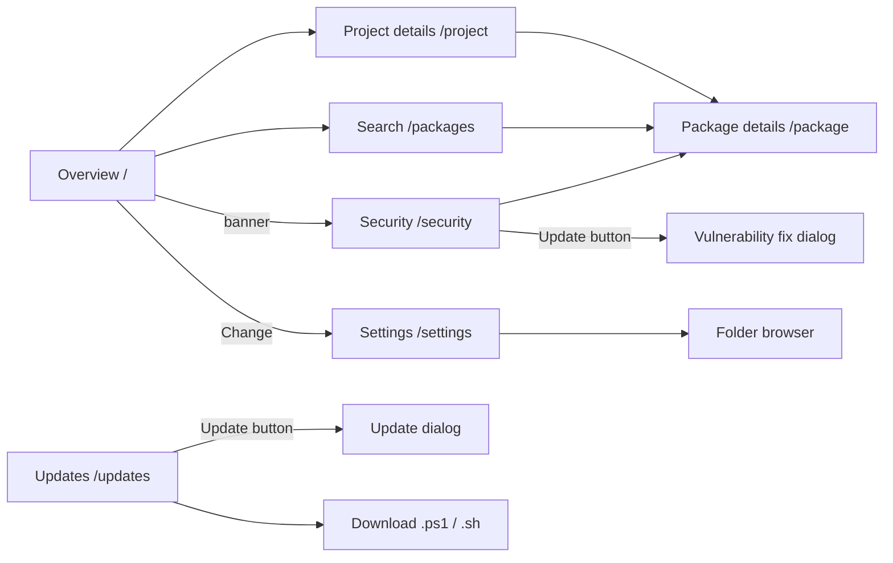

## 1. Package scanning (pkgscan)

When you click **Rescan** (or **Save & scan now**), the server calls `POST /api/scan`. This route runs the `pkgscan scan` binary only: fixed path, fixed arguments, no shell, and only one scan at a time.

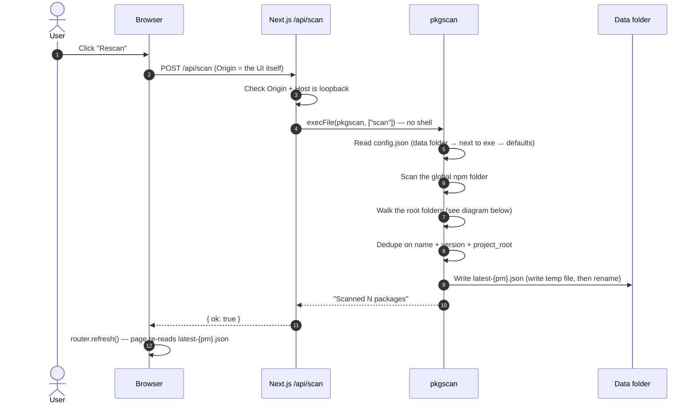

**How pkgscan walks folders:**

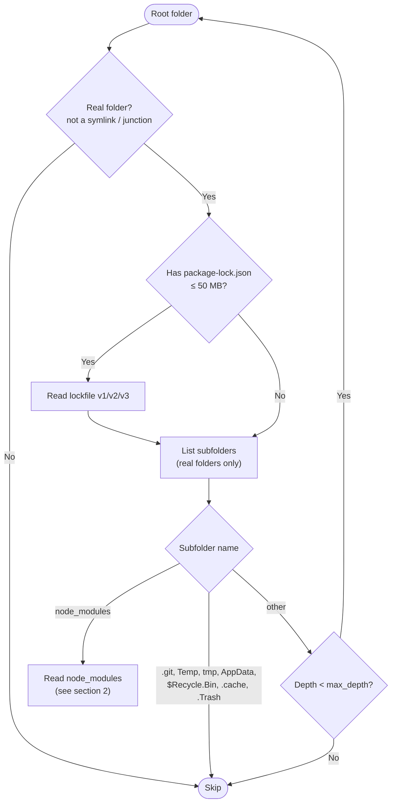

**Safety limits while walking:**

| Limit | Value | Location in code |
|---|---|---|
| Default folder depth | 8 (adjustable from 1–20) | `agent/config.go` |
| Nested `node_modules` depth | 12 | `agent/nodemodules.go` |
| Maximum file size | 50 MB | `agent/walk.go` |
| Symlink / junction / mount point | Always skipped | `isPlainDir()` in `agent/walk.go` |
| Stored install-script length | 2,000 characters | `agent/nodemodules.go` |

## 2. Reading lockfiles and node_modules

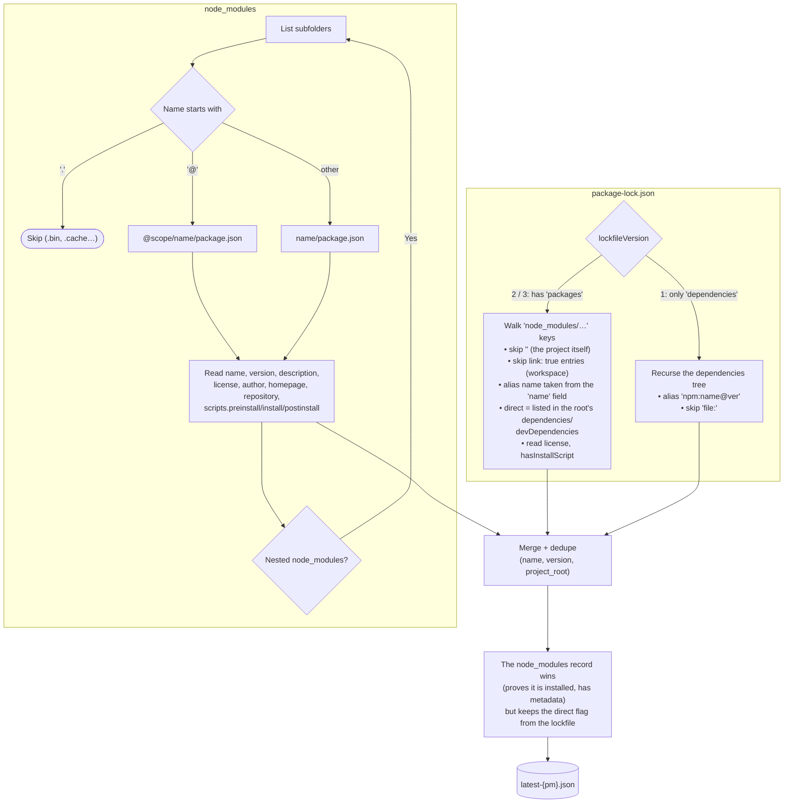

Each record has a `scope`:
- `project`: belongs to a project; `project_root` is the folder that contains the lockfile or the top-level `node_modules`.
- `global`: belongs to the global npm folder:
  - Windows: `%AppData%\npm\node_modules`
  - macOS / Linux: `/usr/local/lib/node_modules`, `~/.npm-global/lib/node_modules`

## 3. Configuring scan folders

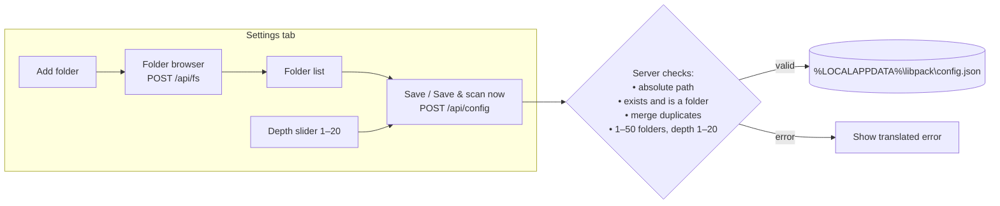

**Order in which the agent looks for configuration** (the first file that exists is used):

1. `<data folder>/config.json`: written by the UI.
2. `config.json` next to the `pkgscan` binary: handy when using the command line on its own.
3. Defaults:
   - Windows: `~\source`, `~\Documents`, `~\code`, `~\projects`, `~\repos`, `~\Desktop`
   - macOS / Linux: `~/code`, `~/projects`, `~/src`, `~/dev`, `~/repos`, `~/Documents`, `~/Desktop`

The folder browser **only lists subfolder names**; it never reads file contents. It hides symlinks, junctions and system folders, and marks any folder that has a `package.json` or `node_modules` as a **"Node project"**.

## 4. Checking for new versions

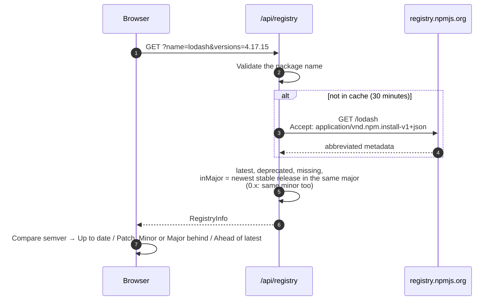

The UI uses this on the package details page, the project page ("Check all for updates", 6 parallel requests) and the Updates tab.

## 5. Security checks

The Security tab combines two sources: **offline analysis** of install scripts, and an **online lookup** against OSV.dev.

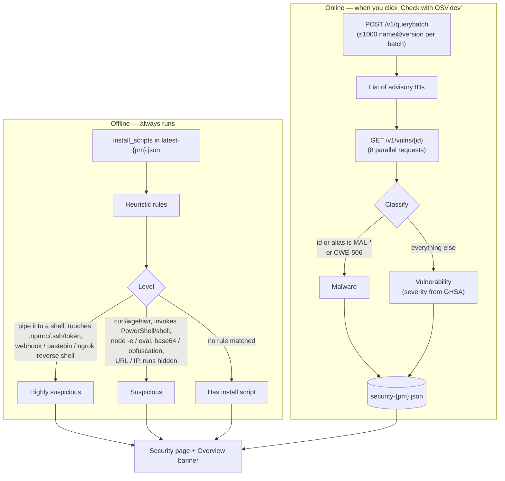

**What is sent out:** only **package names and versions** — no paths, machine name or file contents.

**Why not detect malware by keyword?** When tested on real data, searching descriptions for the word "malicious" flagged ordinary vulnerabilities, e.g. *"a malicious package could…"* in the `pnpm` and `tar` advisories. So the tool relies only on **structured data**: OpenSSF `MAL-*` IDs and GitHub's `CWE-506` ("Embedded Malicious Code").

**When malware is found**, the page shows a red box with 4 steps:
1. Do not run `npm install` / `npm run` in the affected folders.
2. Delete `node_modules` and remove the package.
3. Change passwords, revoke npm / GitHub / cloud tokens and SSH keys.
4. Report it to IT.

## 6. One-click vulnerability fix

Each row in the **Published vulnerabilities** table has an **Update** button. The browser **only says which package in which folder**; the server builds the npm command itself.

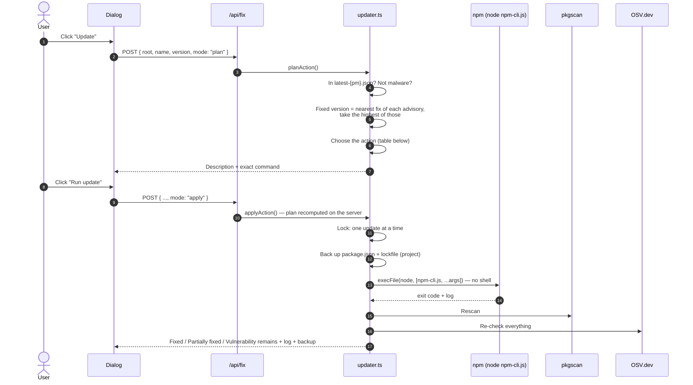

**The server chooses the action:**

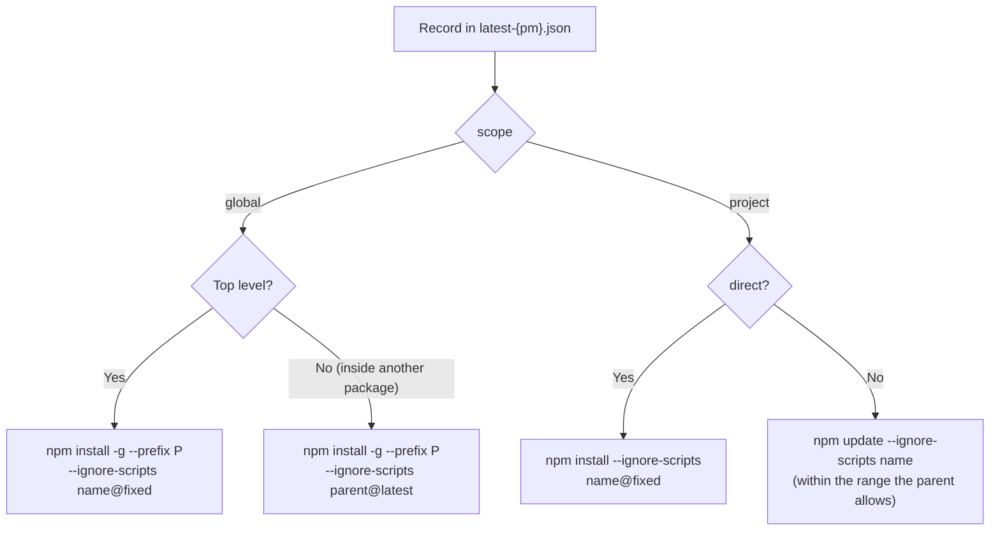

| Result | Meaning |
|---|---|
| ✅ **Fixed** | Every install of the package in that folder is ≥ the fixed version. |
| ⚠️ **Partially fixed** | Some installs were upgraded, some are still old (several nested copies). |
| ❌ **Vulnerability remains** | npm finished, but a parent package pins the old version (e.g. `express@4.17.1` pins `qs@6.7.0`). The parent package needs updating. |

> Example of how the fixed version is chosen: `protobufjs@7.5.4` has fixes in 6.11.6, 7.5.5 and 8.0.1. The tool picks **7.5.5** (the nearest), not 8.0.1.

## 7. Planning and updating outdated packages

The **Updates** tab looks at the **direct packages** of every project and the **top-level global packages**. Transitive packages are controlled by their parent, so they are not listed here.

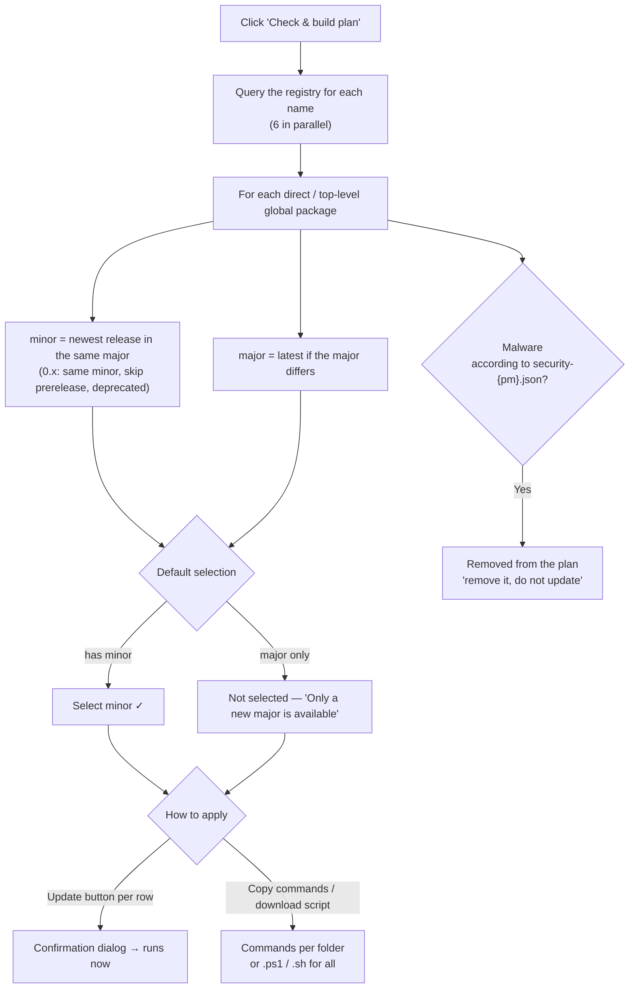

**The Update button on each row:** uses the same guardrails as [section 6](#6-one-click-vulnerability-fix), plus two extra checks because the target version is chosen by the user:

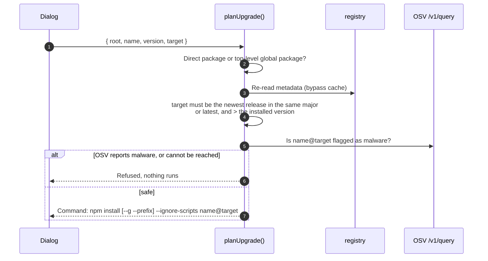

**Downloaded scripts** (e.g. `.ps1`): every path and package name is wrapped in single quotes using correct PowerShell / sh syntax, a failing folder does not stop the remaining folders, and the failed folders are listed at the end.

```powershell
# libpack update plan - generated 2026-11-07T…
# Review before running. --ignore-scripts: package install scripts will NOT run.
$failed = @()

Write-Host '==> C:\Users\me\proj' -ForegroundColor Cyan
Push-Location -LiteralPath 'C:\Users\me\proj'
npm.cmd install --ignore-scripts 'express@4.22.3' 'lodash@4.18.1'
if ($LASTEXITCODE -ne 0) { $failed += 'C:\Users\me\proj' }
Pop-Location

if ($failed.Count) { Write-Warning ("Failed: " + ($failed -join ", ")) } else { Write-Host "Done." -ForegroundColor Green }
```

## 8. Language and theme

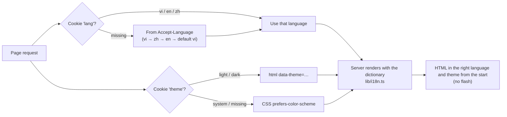

- The dictionaries live in `ui/src/lib/i18n.ts`. The `MessageKey` type is derived from the Vietnamese dictionary, so **a key missing from en or zh is a TypeScript error at build time**.
- Errors returned by the API are translated as well (`I18nError` → `errorMessage()`).
- Dates and numbers are formatted with `vi-VN`, `en-US`, `zh-CN`. Chinese text uses system fonts (Microsoft YaHei, PingFang SC, Noto Sans SC).
