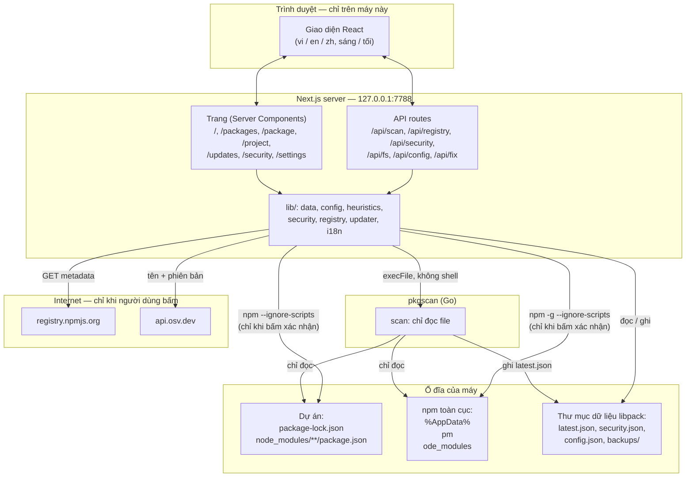

# Kiến trúc

> Tài liệu chi tiết của **LIBPACK**. Xem tổng quan ở [README](../../README.vi.md) · [English](../en/architecture.md) · [简体中文](../zh-CN/architecture.md).

## Tổng quan



**Nguyên tắc thiết kế**

- **Tách biệt quyền hạn.** `pkgscan` chỉ đọc file, nên có thể chạy ở bất kỳ đâu mà không có rủi ro. Mọi hành động có thể thay đổi máy (chạy npm) đều nằm ở server UI, chỉ xảy ra khi người dùng bấm xác nhận, và luôn kèm rào chắn (xem [Mô hình an toàn](security.md)).
- **Không cơ sở dữ liệu.** Mọi trạng thái nằm trong vài file JSON ở thư mục dữ liệu riêng của libpack.
- **Ưu tiên offline.** Quét, tìm kiếm và phân tích script cài đặt đều chạy offline. Mạng chỉ dùng khi bấm nút kiểm tra registry hoặc OSV, hay khi cập nhật.
- **Không phụ thuộc thêm.** Agent chỉ dùng thư viện chuẩn của Go. UI chỉ dùng `next`, `react`, `react-dom` (cùng `typescript` và `@types/*` lúc phát triển); i18n, theme và semver đều tự viết.

## Cấu trúc mã nguồn

```
libpack-guard/
├── README.md / README.vi.md / README.zh-CN.md   # tổng quan (English / Tiếng Việt / 简体中文)
├── docs/
│   ├── en/  vi/  zh-CN/            # tài liệu chi tiết theo ngôn ngữ
│   └── <ngôn ngữ>/{workflows, architecture, security, api, development}.md
├── .gitignore
├── agent/                          # pkgscan — Go, chỉ thư viện chuẩn
│   ├── main.go                     # lệnh scan / find / version, ghi latest.json
│   ├── config.go                   # đọc config.json (thư mục dữ liệu → cạnh exe → mặc định)
│   ├── datadir.go                  # thư mục dữ liệu theo hệ điều hành
│   ├── walk.go                     # duyệt an toàn: isPlainDir, giới hạn 50 MB, danh sách bỏ qua
│   ├── scan.go                     # duyệt các thư mục gốc, loại trùng, thông tin máy
│   ├── lockfile.go                 # package-lock v1 / v2 / v3, alias, direct, hasInstallScript
│   ├── nodemodules.go              # node_modules/<tên>, @scope/<tên>, lồng nhau, install scripts
│   ├── global.go                   # thư mục npm toàn cục
│   ├── payload.go                  # kiểu dữ liệu Result / Package
│   ├── agent_test.go               # unit test (xem docs/development.md)
│   ├── testdata/                   # lockfile v1, v3, scoped, global, script đáng ngờ
│   ├── build.ps1 / build.sh        # build windows/amd64, darwin/arm64, darwin/amd64, linux/amd64
│   └── config.example.json
└── ui/                             # Next.js 16, TypeScript
    ├── .env.example
    └── src/
        ├── app/
        │   ├── layout.tsx          # header, nav, chọn ngôn ngữ / theme, font Inter
        │   ├── globals.css         # design tokens sáng / tối, responsive
        │   ├── page.tsx            # Tổng quan
        │   ├── packages/ package/ project/ updates/ security/ settings/
        │   ├── loading.tsx, icon.svg
        │   └── api/  scan/ registry/ security/ fs/ config/ fix/
        ├── components/
        │   ├── I18nProvider, Preferences, NavLinks, Brand
        │   ├── ScanButton, SecurityCheckButton, SecurityBanner
        │   ├── PackageCheck, ProjectTable, CopyText, registry-client
        │   ├── UpdatePlanner, UpgradeButton, FixButton
        │   └── FolderPicker, ScanSettings
        └── lib/
            ├── data.ts             # đọc latest.json (cache theo mtime), tổng hợp dự án
            ├── agent.ts            # chạy pkgscan
            ├── config.ts           # đọc / ghi config.json, liệt kê thư mục
            ├── heuristics.ts       # luật phân tích script cài đặt
            ├── security.ts         # OSV querybatch / query, phân loại mã độc, security.json
            ├── registry.ts         # npm registry + bestCompatible
            ├── updater.ts          # planAction / planUpgrade / applyAction (chạy npm)
            ├── update-script.ts    # tạo lệnh và script .ps1 / .sh
            ├── semver.ts           # so sánh phiên bản
            ├── http.ts             # sameOrigin + kiểm tra Host loopback
            ├── i18n.ts             # từ điển vi / en / zh, định dạng ngày và số
            └── i18n-server.ts      # đọc cookie lang / theme, Accept-Language
```

## Dữ liệu và định dạng file

### Thư mục dữ liệu

| Hệ điều hành | Đường dẫn |
|---|---|
| Windows | `%LOCALAPPDATA%\libpack\` |
| macOS | `~/Library/Application Support/libpack/` |
| Linux | `$XDG_DATA_HOME/libpack/` hoặc `~/.local/share/libpack/` |

Có thể ghi đè bằng biến môi trường `LIBPACK_DATA_DIR`. Cả pkgscan lẫn UI đều đọc biến này.

```
libpack/
├── latest.json        # kết quả quét gần nhất (pkgscan ghi)
├── security.json      # kết quả đối chiếu OSV gần nhất (UI ghi)
├── config.json        # thư mục quét + độ sâu (UI ghi, pkgscan đọc)
└── backups/
    └── 2026-11-07T06-43-41-007Z/
        └── C_Users_me_proj/
            ├── package.json
            └── package-lock.json
```

### `latest.json`

```jsonc
{
  "machine": { "hostname": "PC-01", "os": "windows", "arch": "amd64", "username": "PC-01\\me" },
  "agent_version": "0.1.0",
  "scanned_at": "2026-11-07T04:38:26Z",
  "roots": ["C:\\Users\\me\\projects"],
  "packages": [
    {
      "ecosystem": "npm",
      "name": "@org/pkg",
      "version": "2.0.0",
      "scope": "project",                 // "project" | "global"
      "project_root": "C:\\Users\\me\\projects\\app",
      "source_file": "C:\\Users\\me\\projects\\app\\node_modules\\@org\\pkg\\package.json",
      "direct": true,                     // lockfile v2/v3: là phụ thuộc trực tiếp
      "description": "…", "license": "MIT", "author": "Org",
      "homepage": "https://…", "repository": "https://github.com/org/pkg",
      "install_scripts": { "postinstall": "node install.js" },   // chỉ là văn bản, không chạy
      "has_install_script": true
    }
  ]
}
```

Các bản ghi được loại trùng theo **`name + version + project_root`**.

### `security.json`

```jsonc
{
  "checked_at": "2026-11-07T05:09:49Z",
  "scan_at": "2026-11-07T04:38:26Z",       // khác scanned_at hiện tại → UI báo "cần kiểm tra lại"
  "queried": 1155,
  "advisories": [
    {
      "id": "GHSA-35jh-r3h4-6jhm",
      "kind": "vuln",                        // "malware" | "vuln"
      "severity": "high",                    // critical | high | moderate | low | unknown
      "summary": "Command Injection in lodash",
      "aliases": ["CVE-2021-23337"],
      "url": "https://osv.dev/vulnerability/GHSA-35jh-r3h4-6jhm",
      "hits": [{ "name": "lodash", "version": "4.17.15", "fixed": ["4.17.21"] }]
    }
  ],
  "errors": []
}
```

### `config.json`

```json
{ "roots": ["C:\\Users\\me\\projects", "D:\\work"], "max_depth": 8 }
```

`roots` để trống thì dùng thư mục mặc định. Khi sửa tay, đường dẫn Windows phải viết bằng `/` hoặc `\\`.

### Biến môi trường (UI)

| Biến | Mặc định | Ý nghĩa |
|---|---|---|
| `LIBPACK_DATA_DIR` | xem [Thư mục dữ liệu](#thư-mục-dữ-liệu) | Thư mục dữ liệu |
| `LIBPACK_AGENT_PATH` | `../agent/dist/pkgscan-<os>-<arch>[.exe]` | Đường dẫn file pkgscan |
| `NPM_REGISTRY_URL` | `https://registry.npmjs.org` | Registry dùng để tra phiên bản |

Xem `ui/.env.example`.
