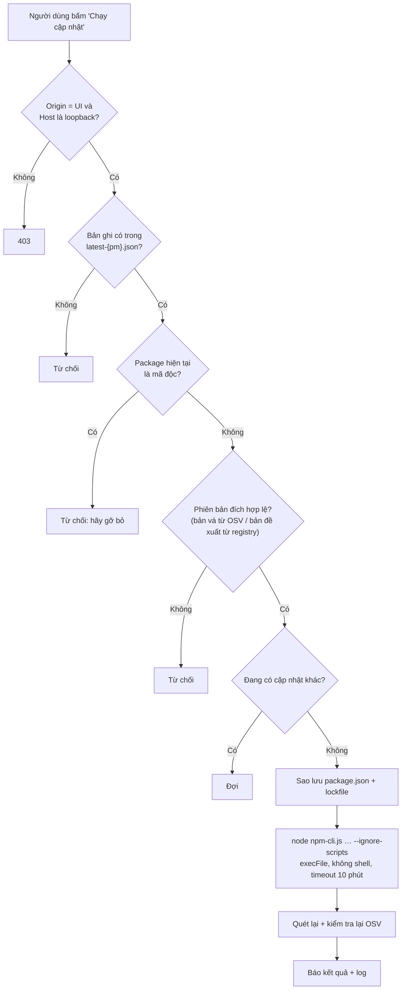

# Mô hình an toàn

> Tài liệu chi tiết của **LIBPACK**. Xem tổng quan ở [README](../../README.vi.md) · [English](../en/security.md) · [简体中文](../zh-CN/security.md).

## Ai được làm gì

| Thành phần | Đọc | Ghi | Chạy tiến trình | Mạng |
|---|---|---|---|---|
| **pkgscan** | Chỉ `package-lock.json` và `node_modules/**/package.json` | Chỉ thư mục dữ liệu libpack | **Không bao giờ** (có test chặn import `os/exec`, `syscall`) | **Không** |
| **Server UI** | `latest-{pm}.json`, `security-{pm}.json`, `config.json`; tên thư mục con (bộ duyệt) | `config.json`, `security-{pm}.json`, `backups/` | `pkgscan scan`; `npm` **chỉ khi người dùng xác nhận** | registry.npmjs.org, api.osv.dev, chỉ khi bấm |
| **Trình duyệt** | Qua API | Cookie `lang`, `theme` | Không | Chỉ tới `127.0.0.1` |

## Rào chắn khi chạy npm

| Rủi ro | Biện pháp |
|---|---|
| Script cài đặt độc hại tự chạy | Luôn `--ignore-scripts` và `npm_config_ignore_scripts=true` |
| Chèn lệnh qua tên package hoặc đường dẫn | Không dùng shell: `execFile(node, [npm-cli.js, ...args])`. Tên package và phiên bản phải khớp regex chặt. Lệnh do server tạo. |
| Trang web khác gọi API local | Kiểm tra `Origin` phải khớp `Host`, và `Host` phải là `127.0.0.1` / `localhost` / `[::1]` (chặn DNS rebinding) |
| Cài nhầm một phiên bản độc hại | Bản đích phải là bản do kế hoạch đề xuất (registry đọc lại) và được OSV xác nhận không phải mã độc; nếu không kiểm tra được thì không chạy |
| Làm hỏng dự án | Sao lưu `package.json` + lockfile vào `backups/<thời điểm>/…` trước khi chạy |
| Hai lệnh npm chạy chồng nhau | Khoá: mỗi lúc chỉ một cập nhật |
| Đi vào vòng lặp junction / symlink | `isPlainDir()` bỏ qua `ModeSymlink` và `ModeIrregular`; có test vòng lặp symlink |
| File quá lớn làm treo | Bỏ qua file > 50 MB |
| Lộ thông tin khi tra OSV | Chỉ gửi tên + phiên bản |
| Ai đó trong mạng LAN mở UI | Server chỉ lắng nghe trên `127.0.0.1` |

## Xem thêm

- [Kiểm tra bảo mật](workflows.md#5-kiểm-tra-bảo-mật): phân tích script cài đặt và đối chiếu OSV.dev
- [Vá lỗ hổng bằng một nút bấm](workflows.md#6-vá-lỗ-hổng-bằng-một-nút-bấm)
- [Lập kế hoạch và cập nhật package cũ](workflows.md#7-lập-kế-hoạch-và-cập-nhật-package-cũ)
