# Workflow

> Tài liệu chi tiết của **LIBPACK**. Xem tổng quan ở [README](../../README.vi.md) · [English](../en/workflows.md) · [简体中文](../zh-CN/workflows.md).

## Các màn hình và điều hướng

| Tab / trang | Đường dẫn | Chức năng chính |
|---|---|---|
| **Tổng quan** | `/` | Banner bảo mật, số liệu (bản cài, package khác nhau, dự án, cài toàn cục), danh sách dự án và thư mục toàn cục, nút **Quét lại**. |
| **Chi tiết dự án** | `/project?root=…` | Package trực tiếp hoặc tất cả, lọc theo tên, nút **"Kiểm tra phiên bản mới cho tất cả"** (tối đa 300 package), lọc "chỉ package cũ". |
| **Tìm package** | `/packages?q=&v=&exact=` | Tìm theo tên (một phần hoặc chính xác), lọc phiên bản. Kết quả: package, phiên bản, loại, thư mục, file nguồn. |
| **Chi tiết package** | `/package?name=…` | Mô tả, license, tác giả, link npm / homepage / repo, cảnh báo bảo mật, nút **"Kiểm tra phiên bản mới"**, danh sách nơi cài. |
| **Cập nhật** | `/updates` | Lập kế hoạch cập nhật cho mọi dự án. Nút **Cập nhật** ở từng dòng, hoặc chép lệnh / tải script `.ps1` / `.sh`. |
| **Bảo mật** | `/security` | Package độc hại, script cài đặt đáng ngờ, lỗ hổng đã công bố (có nút **Cập nhật** từng dòng), các package khác có script cài đặt. |
| **Cài đặt** | `/settings` | Chọn thư mục quét bằng bộ duyệt thư mục, chỉnh độ sâu, **Lưu** / **Lưu và quét ngay**. |

**Thanh trên cùng** có bộ chọn ngôn ngữ **VI · EN · 中** và bộ chọn giao diện ☀ / ☾ / 🖥.

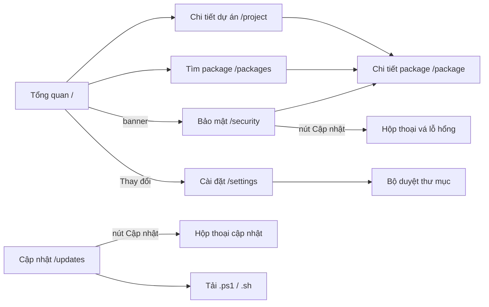

## 1. Quét package (pkgscan)

Khi bấm **Quét lại** (hoặc **Lưu và quét ngay**), server gọi `POST /api/scan`. Route này chạy đúng file `pkgscan scan`: đường dẫn cố định, tham số cố định, không qua shell, và mỗi lúc chỉ có một lượt quét.

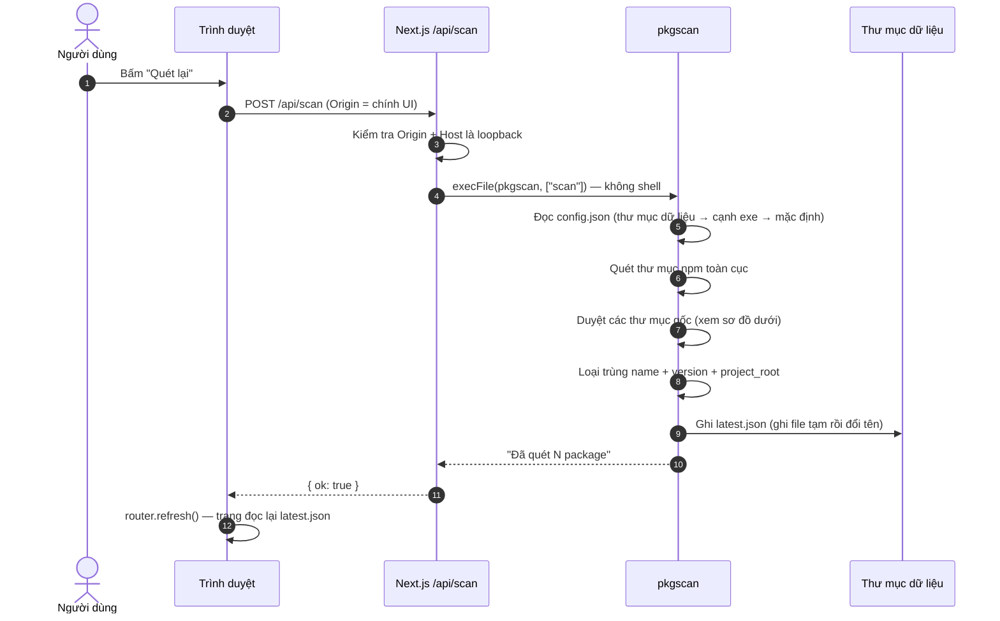

**Cách pkgscan duyệt thư mục:**

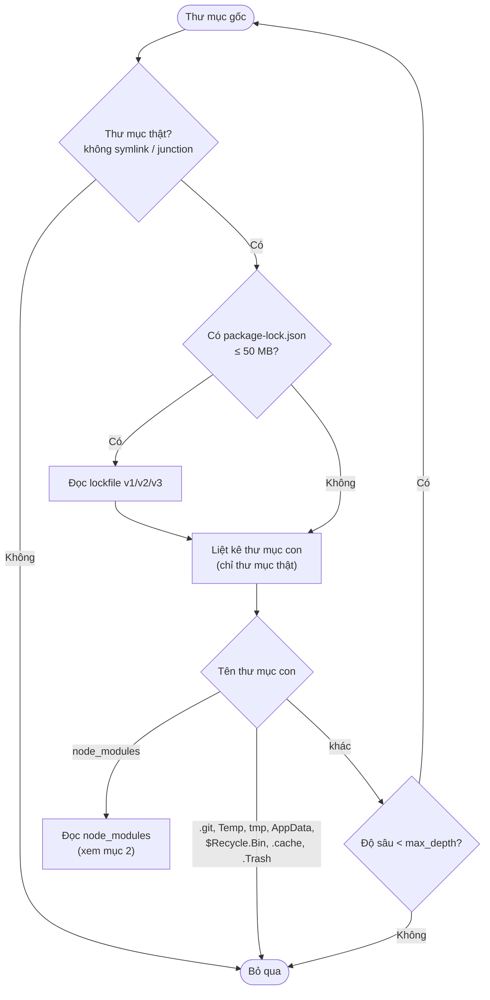

**Giới hạn an toàn khi duyệt:**

| Giới hạn | Giá trị | Vị trí trong code |
|---|---|---|
| Độ sâu thư mục mặc định | 8 (chỉnh được từ 1–20) | `agent/config.go` |
| Độ sâu `node_modules` lồng nhau | 12 | `agent/nodemodules.go` |
| Kích thước file tối đa | 50 MB | `agent/walk.go` |
| Symlink / junction / mount point | Luôn bỏ qua | `isPlainDir()` trong `agent/walk.go` |
| Độ dài script cài đặt lưu lại | 2.000 ký tự | `agent/nodemodules.go` |

## 2. Đọc lockfile và node_modules

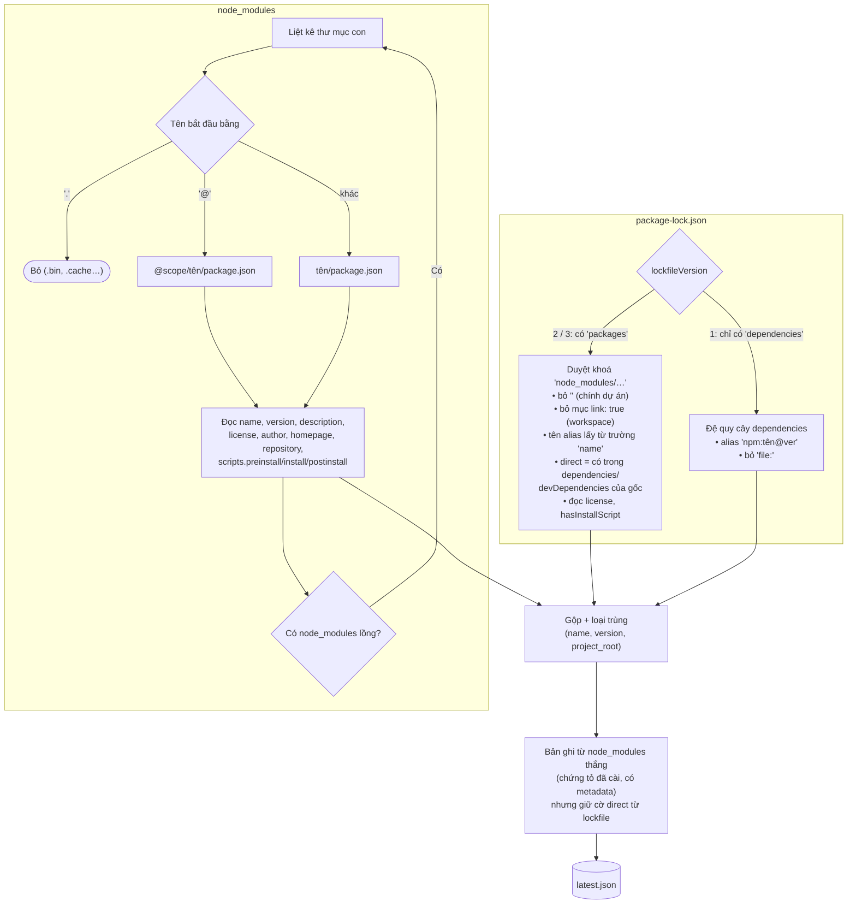

Mỗi bản ghi có `scope`:
- `project`: thuộc một dự án; `project_root` là thư mục chứa lockfile hoặc `node_modules` cấp cao nhất.
- `global`: thuộc thư mục npm toàn cục:
  - Windows: `%AppData%\npm\node_modules`
  - macOS / Linux: `/usr/local/lib/node_modules`, `~/.npm-global/lib/node_modules`

## 3. Cấu hình thư mục quét

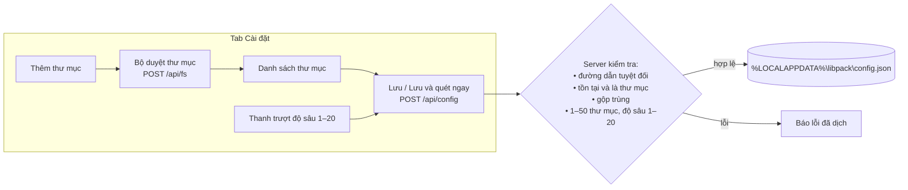

**Thứ tự agent tìm cấu hình** (file đầu tiên tồn tại sẽ được dùng):

1. `<thư mục dữ liệu>/config.json`: do giao diện ghi.
2. `config.json` đặt cạnh file `pkgscan`: tiện khi dùng riêng bằng dòng lệnh.
3. Mặc định:
   - Windows: `~\source`, `~\Documents`, `~\code`, `~\projects`, `~\repos`, `~\Desktop`
   - macOS / Linux: `~/code`, `~/projects`, `~/src`, `~/dev`, `~/repos`, `~/Documents`, `~/Desktop`

Bộ duyệt thư mục **chỉ liệt kê tên thư mục con**, không đọc nội dung file. Nó ẩn symlink, junction và thư mục hệ thống, đồng thời đánh dấu **"dự án Node"** cho thư mục nào có `package.json` hoặc `node_modules`.

## 4. Kiểm tra phiên bản mới

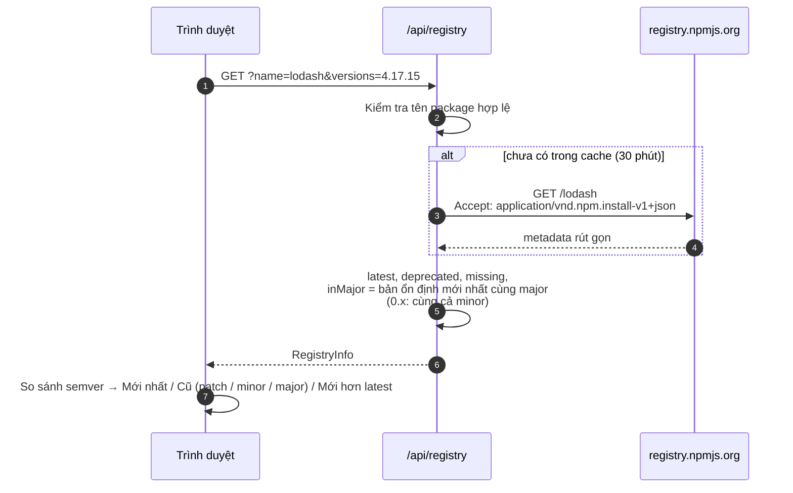

Giao diện dùng thông tin này ở trang chi tiết package, trang dự án ("kiểm tra tất cả", 6 request song song) và tab Cập nhật.

## 5. Kiểm tra bảo mật

Tab Bảo mật kết hợp hai nguồn: **phân tích offline** các script cài đặt, và **đối chiếu trực tuyến** với OSV.dev.

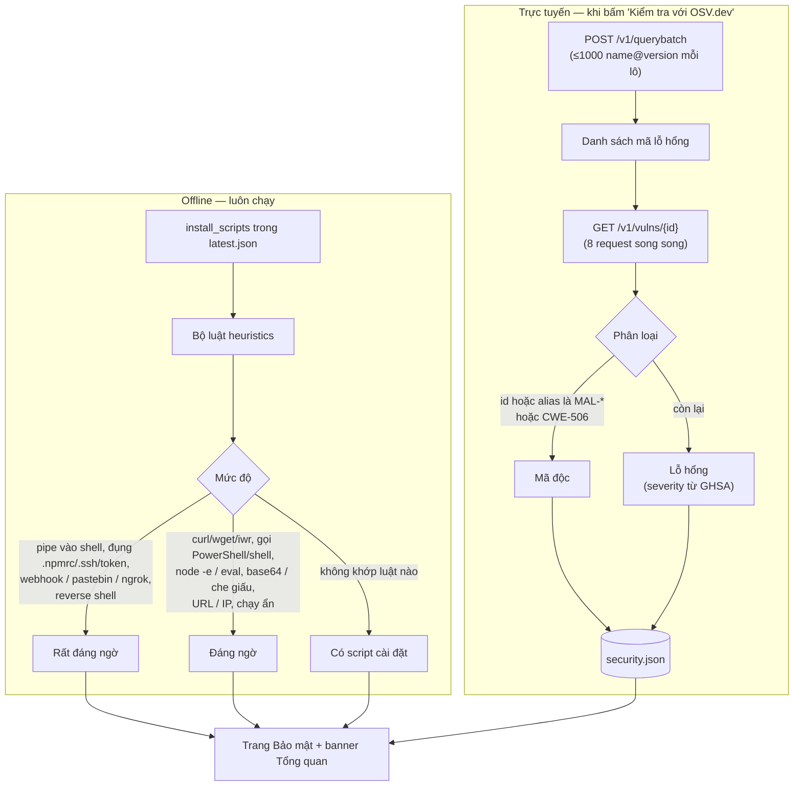

**Thông tin gửi ra ngoài:** chỉ **tên và phiên bản package**, không có đường dẫn, tên máy hay nội dung file.

**Vì sao không nhận diện mã độc bằng từ khoá?** Khi thử với dữ liệu thật, cách tìm từ "malicious" trong mô tả báo nhầm các lỗ hổng thường, ví dụ *"a malicious package could…"* trong advisory của `pnpm` và `tar`. Vì vậy công cụ chỉ dựa vào **dữ liệu có cấu trúc**: mã `MAL-*` của OpenSSF và mã `CWE-506` ("Embedded Malicious Code") của GitHub.

**Khi phát hiện mã độc**, trang hiện khung đỏ kèm 4 bước xử lý:
1. Không chạy `npm install` / `npm run` ở các thư mục bị ảnh hưởng.
2. Xoá `node_modules` và gỡ package.
3. Đổi mật khẩu, thu hồi token npm / GitHub / cloud và SSH key.
4. Báo IT.

## 6. Vá lỗ hổng bằng một nút bấm

Mỗi dòng trong bảng **Lỗ hổng bảo mật đã công bố** có nút **Cập nhật**. Trình duyệt **chỉ cho biết package nào ở thư mục nào**; lệnh npm do server tự tạo.

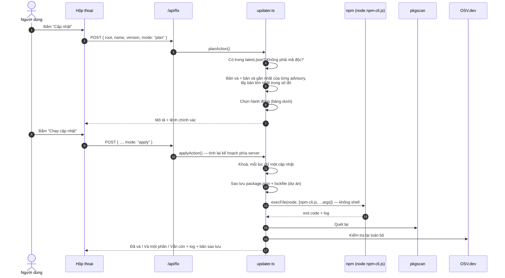

**Server tự chọn hành động:**

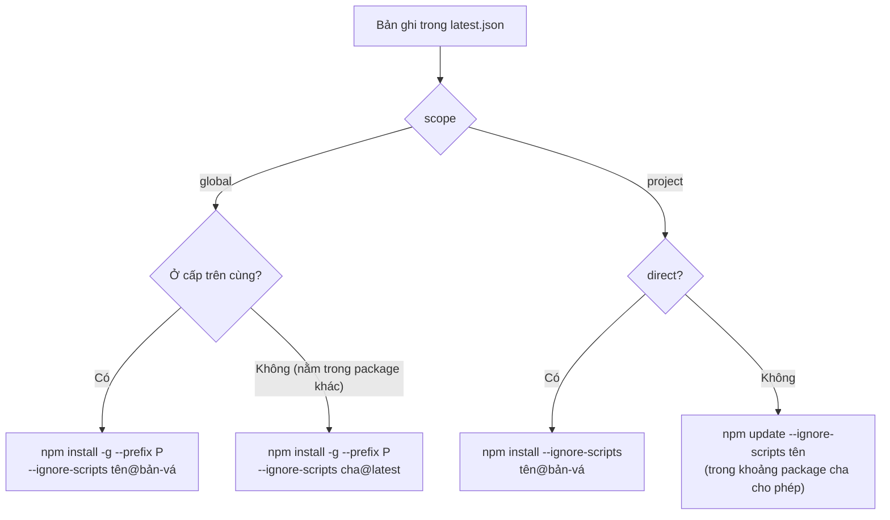

| Kết quả | Ý nghĩa |
|---|---|
| ✅ **Đã vá** | Mọi bản cài của package trong thư mục đó đều ≥ bản vá. |
| ⚠️ **Vá một phần** | Một số bản đã lên, một số vẫn cũ (nhiều bản lồng nhau). |
| ❌ **Vẫn còn** | npm chạy xong nhưng package cha khoá cứng phiên bản cũ (ví dụ `express@4.17.1` khoá `qs@6.7.0`). Cần cập nhật package cha. |

> Ví dụ cách chọn bản vá: `protobufjs@7.5.4` có các bản vá 6.11.6, 7.5.5 và 8.0.1. Công cụ chọn **7.5.5** (gần nhất), không nhảy lên 8.0.1.

## 7. Lập kế hoạch và cập nhật package cũ

Tab **Cập nhật** xét các **package trực tiếp** của mọi dự án và các **package global cấp trên cùng**. Package gián tiếp do package cha quyết định nên không nằm ở đây.

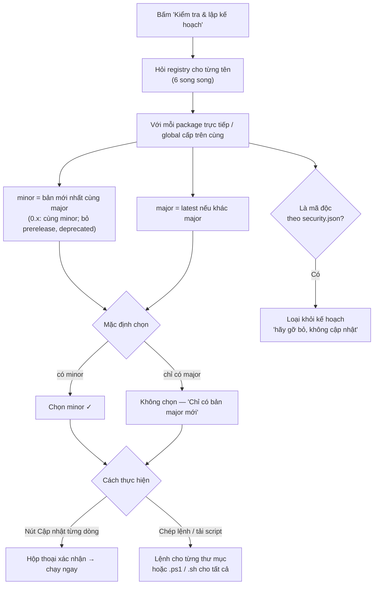

**Nút Cập nhật ở từng dòng:** dùng chung rào chắn với [mục 6](#6-vá-lỗ-hổng-bằng-một-nút-bấm), cộng thêm hai kiểm tra vì phiên bản đích do người dùng chọn:

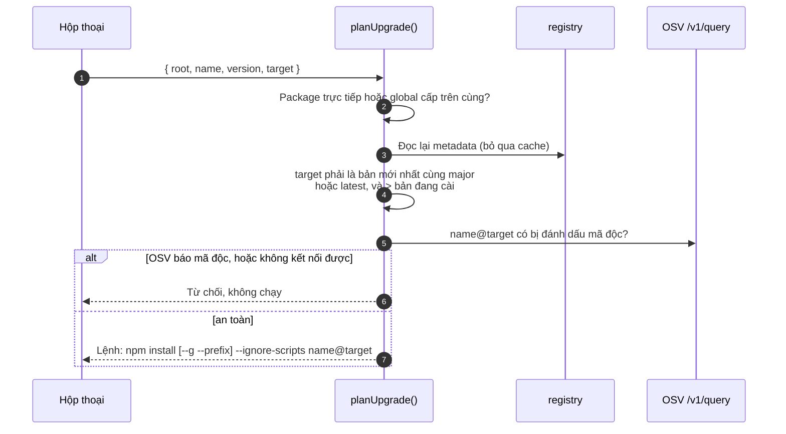

**Script tải về** (ví dụ `.ps1`): mọi đường dẫn và tên package đều được đặt trong nháy đơn đúng cú pháp PowerShell / sh, thư mục nào lỗi thì vẫn chạy tiếp các thư mục còn lại, và cuối cùng liệt kê các thư mục lỗi.

```powershell
# libpack update plan - generated 2026-11-07T…
# Review before running. --ignore-scripts: package install scripts will NOT run.
$failed = @()

Write-Host '==> C:\Users\me\proj' -ForegroundColor Cyan
Push-Location -LiteralPath 'C:\Users\me\proj'
npm.cmd install --ignore-scripts 'express@4.22.3' 'lodash@4.18.1'
if ($LASTEXITCODE -ne 0) { $failed += 'C:\Users\me\proj' }
Pop-Location

if ($failed.Count) { Write-Warning ("Failed: " + ($failed -join ", ")) } else { Write-Host "Done." -ForegroundColor Green }
```

## 8. Ngôn ngữ và giao diện

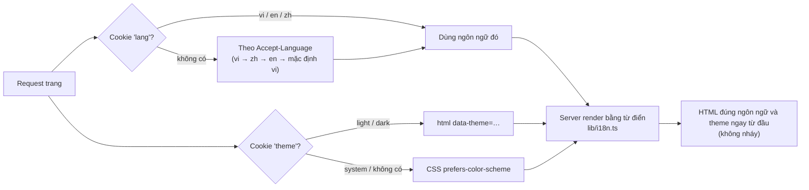

- Từ điển nằm trong `ui/src/lib/i18n.ts`. Kiểu `MessageKey` lấy từ bản tiếng Việt, nên **thiếu một key ở en hoặc zh là TypeScript báo lỗi ngay lúc build**.
- Lỗi trả về từ API cũng được dịch (`I18nError` → `errorMessage()`).
- Ngày và số được định dạng theo `vi-VN`, `en-US`, `zh-CN`. Chữ Trung dùng font hệ thống (Microsoft YaHei, PingFang SC, Noto Sans SC).
