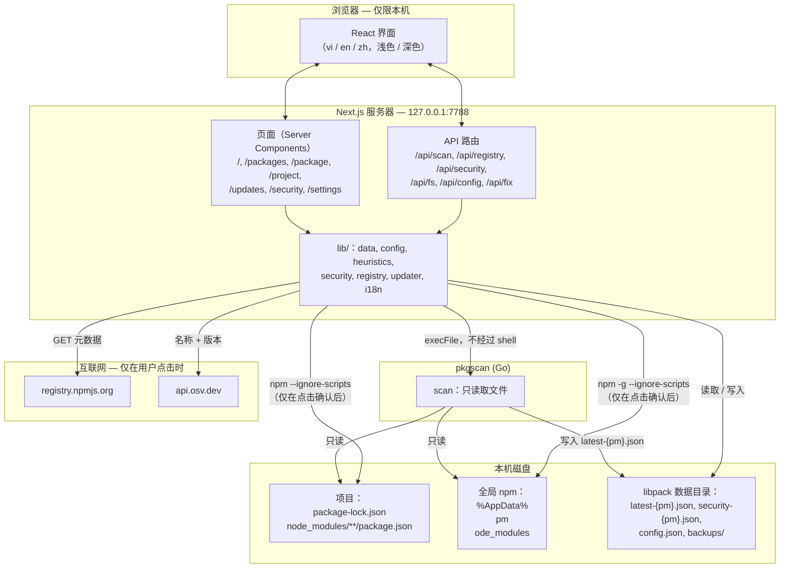

# 架构

> **LIBPACK** 详细文档。概览：[README](../../README.zh-CN.md) · [English](../en/architecture.md) · [Tiếng Việt](../vi/architecture.md)。

## 整体架构



**设计原则**

- **权限分离。** `pkgscan` 只读取文件，因此可以在任何地方运行而没有风险。所有可能改动机器的操作（运行 npm）都在界面服务器中，只在用户点击确认后发生，并且始终有防护措施（见[安全模型](security.md)）。
- **无数据库。** 所有状态都保存在 libpack 专用数据目录中的几个 JSON 文件里。
- **离线优先。** 扫描、搜索和安装脚本分析都离线运行。只有在点击检查 registry 或 OSV 的按钮，或执行更新时才会联网。
- **不增加依赖。** 代理只使用 Go 标准库。界面只使用 `next`、`react`、`react-dom`（开发时另加 `typescript` 和 `@types/*`）；i18n、主题和 semver 均为自行实现。

## 源码结构

```
libpack-guard/
├── README.md / README.vi.md / README.zh-CN.md   # 概览（English / Tiếng Việt / 简体中文）
├── docs/
│   ├── en/  vi/  zh-CN/            # 按语言划分的详细文档
│   └── <语言>/{workflows, architecture, security, api, development}.md
├── .gitignore
├── agent/                          # pkgscan — Go，仅使用标准库
│   ├── main.go                     # scan / find / version 命令，写入 latest-{pm}.json
│   ├── config.go                   # 读取 config.json（数据目录 → exe 旁 → 默认）
│   ├── datadir.go                  # 按操作系统确定数据目录
│   ├── walk.go                     # 安全遍历：isPlainDir、50 MB 限制、跳过列表
│   ├── scan.go                     # 遍历各根目录、去重、机器信息
│   ├── lockfile.go                 # package-lock v1 / v2 / v3、别名、direct、hasInstallScript
│   ├── nodemodules.go              # node_modules/<名称>、@scope/<名称>、嵌套、install scripts
│   ├── global.go                   # 全局 npm 目录
│   ├── payload.go                  # Result / Package 数据类型
│   ├── agent_test.go               # 单元测试（见 docs/development.md）
│   ├── testdata/                   # lockfile v1、v3、scoped、global、可疑脚本
│   ├── build.ps1 / build.sh        # 构建 windows/amd64、darwin/arm64、darwin/amd64、linux/amd64
│   └── config.example.json
└── ui/                             # Next.js 16，TypeScript
    ├── .env.example
    └── src/
        ├── app/
        │   ├── layout.tsx          # 页头、导航、语言 / 主题选择、Inter 字体
        │   ├── globals.css         # 浅色 / 深色设计令牌、响应式
        │   ├── page.tsx            # 概览
        │   ├── packages/ package/ project/ updates/ security/ settings/
        │   ├── loading.tsx, icon.svg
        │   └── api/  scan/ registry/ security/ fs/ config/ fix/
        ├── components/
        │   ├── I18nProvider, Preferences, NavLinks, Brand
        │   ├── ScanButton, SecurityCheckButton, SecurityBanner
        │   ├── PackageCheck, ProjectTable, CopyText, registry-client
        │   ├── UpdatePlanner, UpgradeButton, FixButton
        │   └── FolderPicker, ScanSettings
        └── lib/
            ├── data.ts             # 读取 latest-{pm}.json（按 mtime 缓存），汇总项目
            ├── agent.ts            # 运行 pkgscan
            ├── config.ts           # 读取 / 写入 config.json，列出目录
            ├── heuristics.ts       # 安装脚本分析规则
            ├── security.ts         # OSV querybatch / query、恶意软件分类、security-{pm}.json
            ├── registry.ts         # npm registry + bestCompatible
            ├── updater.ts          # planAction / planUpgrade / applyAction（运行 npm）
            ├── update-script.ts    # 生成命令和 .ps1 / .sh 脚本
            ├── semver.ts           # 版本比较
            ├── http.ts             # sameOrigin + Host loopback 检查
            ├── i18n.ts             # vi / en / zh 词典，日期和数字格式化
            └── i18n-server.ts      # 读取 lang / theme cookie、Accept-Language
```

## 数据与文件格式

> `{pm}` 为 `npm` 或 `pnpm`。两种包管理器完全分开：各自有独立的扫描文件和安全报告，通过顶部栏的 npm / pnpm 开关选择（cookie `pm`）。

### 数据目录

| 操作系统 | 路径 |
|---|---|
| Windows | `%LOCALAPPDATA%\libpack\` |
| macOS | `~/Library/Application Support/libpack/` |
| Linux | `$XDG_DATA_HOME/libpack/` 或 `~/.local/share/libpack/` |

可以用环境变量 `LIBPACK_DATA_DIR` 覆盖。pkgscan 和界面都会读取这个变量。

```
libpack/
├── latest-{pm}.json        # 最近一次扫描结果（pkgscan 写入）
├── security-{pm}.json      # 最近一次 OSV 比对结果（界面写入）
├── config.json        # 扫描目录 + 深度（界面写入，pkgscan 读取）
└── backups/
    └── 2026-11-07T06-43-41-007Z/
        └── C_Users_me_proj/
            ├── package.json
            └── package-lock.json
```

### `latest-{pm}.json`

```jsonc
{
  "machine": { "hostname": "PC-01", "os": "windows", "arch": "amd64", "username": "PC-01\\me" },
  "agent_version": "0.1.0",
  "scanned_at": "2026-11-07T04:38:26Z",
  "roots": ["C:\\Users\\me\\projects"],
  "packages": [
    {
      "ecosystem": "npm",
      "name": "@org/pkg",
      "version": "2.0.0",
      "scope": "project",                 // "project" | "global"
      "project_root": "C:\\Users\\me\\projects\\app",
      "source_file": "C:\\Users\\me\\projects\\app\\node_modules\\@org\\pkg\\package.json",
      "direct": true,                     // lockfile v2/v3：是直接依赖
      "description": "…", "license": "MIT", "author": "Org",
      "homepage": "https://…", "repository": "https://github.com/org/pkg",
      "install_scripts": { "postinstall": "node install.js" },   // 仅为文本，不会运行
      "has_install_script": true
    }
  ]
}
```

记录按 **`name + version + project_root`** 去重。

### `security-{pm}.json`

```jsonc
{
  "checked_at": "2026-11-07T05:09:49Z",
  "scan_at": "2026-11-07T04:38:26Z",       // 与当前 scanned_at 不同 → 界面提示需要重新检查
  "queried": 1155,
  "advisories": [
    {
      "id": "GHSA-35jh-r3h4-6jhm",
      "kind": "vuln",                        // "malware" | "vuln"
      "severity": "high",                    // critical | high | moderate | low | unknown
      "summary": "Command Injection in lodash",
      "aliases": ["CVE-2021-23337"],
      "url": "https://osv.dev/vulnerability/GHSA-35jh-r3h4-6jhm",
      "hits": [{ "name": "lodash", "version": "4.17.15", "fixed": ["4.17.21"] }]
    }
  ],
  "errors": []
}
```

### `config.json`

```json
{ "roots": ["C:\\Users\\me\\projects", "D:\\work"], "max_depth": 8 }
```

`roots` 为空时使用默认目录。手动编辑时，Windows 路径必须写成 `/` 或 `\\`。

### 界面环境变量

| 变量 | 默认值 | 含义 |
|---|---|---|
| `LIBPACK_DATA_DIR` | 见[数据目录](#数据目录) | 数据目录 |
| `LIBPACK_AGENT_PATH` | `../agent/dist/pkgscan-<os>-<arch>[.exe]` | pkgscan 可执行文件路径 |
| `NPM_REGISTRY_URL` | `https://registry.npmjs.org` | 用于查询版本的 registry |

见 `ui/.env.example`。
