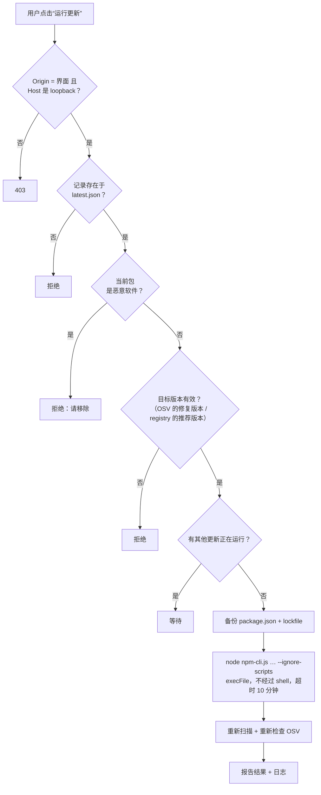

# 安全模型

> **LIBPACK** 详细文档。概览：[README](../../README.zh-CN.md) · [English](../en/security.md) · [Tiếng Việt](../vi/security.md)。

## 各组件的权限

| 组件 | 读取 | 写入 | 运行进程 | 网络 |
|---|---|---|---|---|
| **pkgscan** | 仅 `package-lock.json` 和 `node_modules/**/package.json` | 仅 libpack 数据目录 | **从不**（有测试禁止导入 `os/exec`、`syscall`） | **无** |
| **界面服务器** | `latest.json`、`security.json`、`config.json`；子目录名称（目录浏览器） | `config.json`、`security.json`、`backups/` | `pkgscan scan`；`npm` **仅在用户确认后** | registry.npmjs.org、api.osv.dev，仅在点击时 |
| **浏览器** | 通过 API | Cookie `lang`、`theme` | 无 | 仅访问 `127.0.0.1` |

## 运行 npm 时的防护措施

| 风险 | 对策 |
|---|---|
| 恶意安装脚本自动运行 | 始终使用 `--ignore-scripts` 和 `npm_config_ignore_scripts=true` |
| 通过包名或路径注入命令 | 不使用 shell：`execFile(node, [npm-cli.js, ...args])`。包名和版本必须匹配严格的正则表达式。命令由服务器生成。 |
| 其他网站调用本地 API | 检查 `Origin` 必须与 `Host` 一致，且 `Host` 必须是 `127.0.0.1` / `localhost` / `[::1]`（防止 DNS rebinding） |
| 误装恶意版本 | 目标版本必须是计划推荐的版本（重新读取 registry），并经 OSV 确认不是恶意软件；无法检查时不运行 |
| 损坏项目 | 运行前将 `package.json` + lockfile 备份到 `backups/<时间>/…` |
| 两个 npm 命令同时运行 | 加锁：同一时间只允许一个更新 |
| 陷入 junction / symlink 循环 | `isPlainDir()` 跳过 `ModeSymlink` 和 `ModeIrregular`；有 symlink 循环测试 |
| 文件过大导致卡死 | 跳过 > 50 MB 的文件 |
| 查询 OSV 时泄露信息 | 只发送名称 + 版本 |
| 局域网中的其他人打开界面 | 服务器只监听 `127.0.0.1` |

## 另请参阅

- [安全检查](workflows.md#5-安全检查)：安装脚本分析与 OSV.dev 比对
- [一键修复漏洞](workflows.md#6-一键修复漏洞)
- [规划并更新过期的包](workflows.md#7-规划并更新过期的包)
