# 工作流程

> **LIBPACK** 详细文档。概览：[README](../../README.zh-CN.md) · [English](../en/workflows.md) · [Tiếng Việt](../vi/workflows.md)。

## 页面与导航

| 标签页 / 页面 | 路径 | 主要功能 |
|---|---|---|
| **概览** | `/` | 安全横幅、统计数据（包安装数、不同的包、项目、全局安装）、项目与全局目录列表、**重新扫描** 按钮。 |
| **项目详情** | `/project?root=…` | 直接依赖或全部包、按名称筛选、**“全部检查更新”** 按钮（最多 300 个包）、“仅显示过期”筛选。 |
| **搜索** | `/packages?q=&v=&exact=` | 按名称搜索（部分或精确匹配），按版本筛选。结果：包、版本、类型、目录、来源文件。 |
| **包详情** | `/package?name=…` | 描述、许可证、作者、npm / 主页 / 仓库链接、安全警报、**“检查更新”** 按钮、安装位置列表。 |
| **更新** | `/updates` | 为所有项目制定更新计划。每一行都有 **更新** 按钮，也可以复制命令或下载 `.ps1` / `.sh` 脚本。 |
| **安全** | `/security` | 恶意包、可疑安装脚本、已公开的漏洞（每行有 **更新** 按钮）、其他带安装脚本的包。 |
| **设置** | `/settings` | 用目录浏览器选择扫描目录、调整深度、**保存** / **保存并立即扫描**。 |

**顶部栏** 有语言选择器 **VI · EN · 中** 和主题选择器 ☀ / ☾ / 🖥。

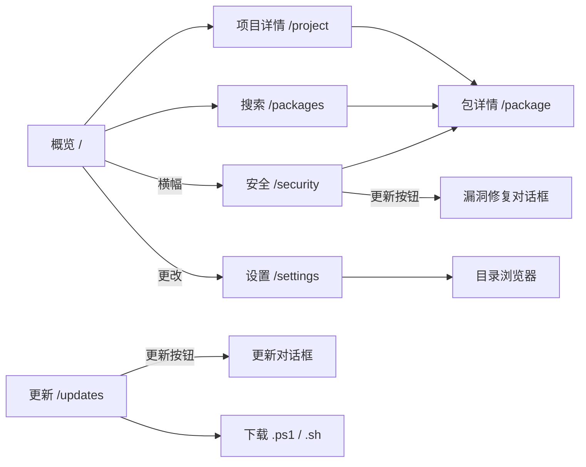

## 1. 使用 pkgscan 扫描包

点击 **重新扫描**（或 **保存并立即扫描**）时，服务器调用 `POST /api/scan`。该路由只运行 `pkgscan scan` 这一个可执行文件：路径固定、参数固定、不经过 shell，并且同一时间只允许一次扫描。

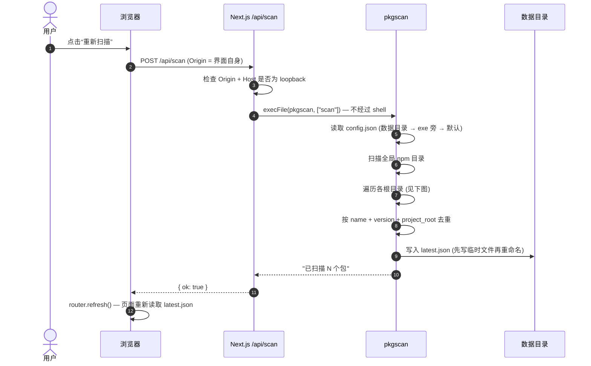

**pkgscan 如何遍历目录：**

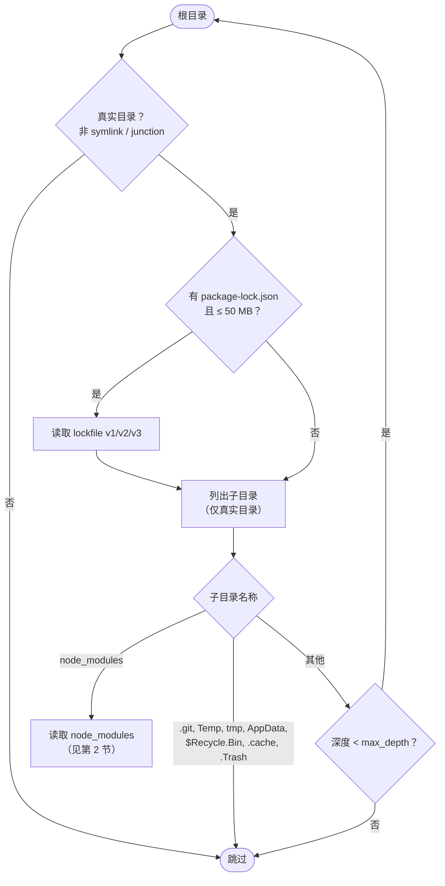

**遍历时的安全限制：**

| 限制 | 值 | 代码位置 |
|---|---|---|
| 默认目录深度 | 8（可在 1–20 之间调整） | `agent/config.go` |
| 嵌套 `node_modules` 深度 | 12 | `agent/nodemodules.go` |
| 最大文件大小 | 50 MB | `agent/walk.go` |
| Symlink / junction / 挂载点 | 始终跳过 | `agent/walk.go` 中的 `isPlainDir()` |
| 保存的安装脚本长度 | 2,000 个字符 | `agent/nodemodules.go` |

## 2. 读取 lockfile 和 node_modules

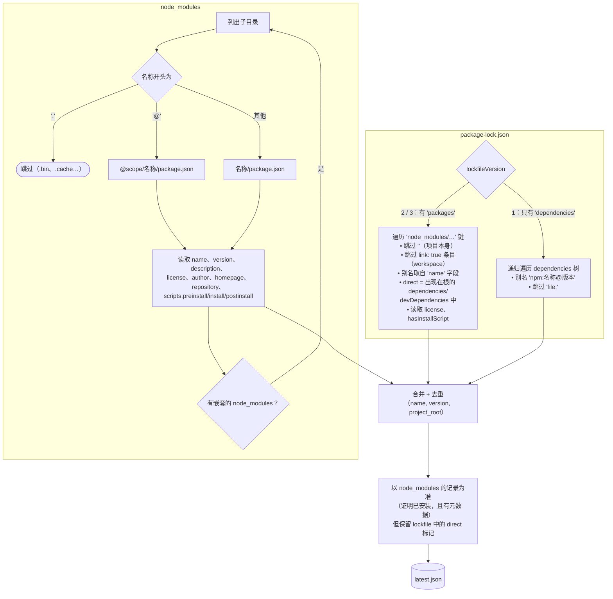

每条记录都有 `scope`：
- `project`：属于某个项目；`project_root` 是包含 lockfile 或顶层 `node_modules` 的目录。
- `global`：属于全局 npm 目录：
  - Windows：`%AppData%\npm\node_modules`
  - macOS / Linux：`/usr/local/lib/node_modules`、`~/.npm-global/lib/node_modules`

## 3. 配置扫描目录

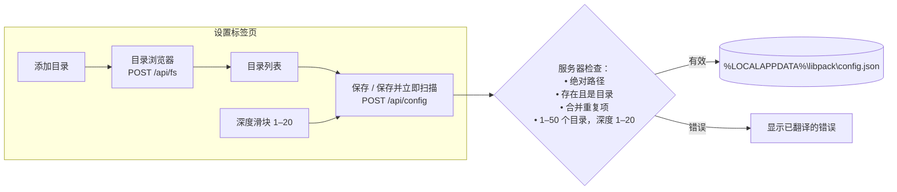

**代理查找配置的顺序**（使用第一个存在的文件）：

1. `<数据目录>/config.json`：由界面写入。
2. 放在 `pkgscan` 可执行文件旁的 `config.json`：便于单独在命令行中使用。
3. 默认值：
   - Windows：`~\source`、`~\Documents`、`~\code`、`~\projects`、`~\repos`、`~\Desktop`
   - macOS / Linux：`~/code`、`~/projects`、`~/src`、`~/dev`、`~/repos`、`~/Documents`、`~/Desktop`

目录浏览器**只列出子目录名称**，不读取文件内容。它会隐藏 symlink、junction 和系统目录，并为包含 `package.json` 或 `node_modules` 的目录标记 **“Node 项目”**。

## 4. 检查新版本

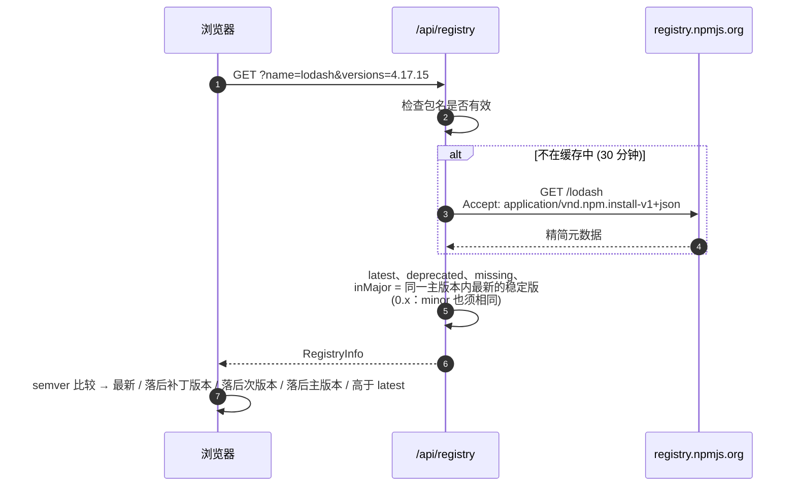

界面在包详情页、项目页（“全部检查更新”，6 个请求并行）和更新标签页中使用这些信息。

## 5. 安全检查

安全标签页结合两种来源：对安装脚本的**离线分析**，以及与 OSV.dev 的**在线比对**。

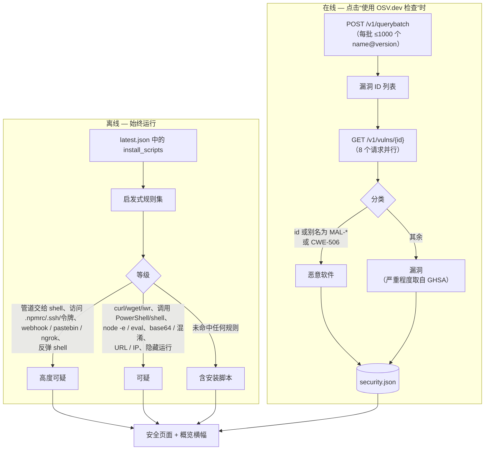

**发送到外部的信息：** 只有**包名和版本**，不包含路径、主机名或文件内容。

**为什么不用关键词识别恶意软件？** 用真实数据测试时，在描述中搜索 “malicious” 一词会误报普通漏洞，例如 `pnpm` 和 `tar` 公告中的 *“a malicious package could…”*。因此工具只依赖**结构化数据**：OpenSSF 的 `MAL-*` 编号和 GitHub 的 `CWE-506`（“Embedded Malicious Code”）。

**检测到恶意软件时**，页面会显示红色框和 4 个处理步骤：
1. 不要在受影响的目录中运行 `npm install` / `npm run`。
2. 删除 `node_modules` 并移除该包。
3. 修改密码，吊销 npm / GitHub / 云服务令牌和 SSH 密钥。
4. 通知 IT。

## 6. 一键修复漏洞

**已公开的漏洞** 表格中的每一行都有 **更新** 按钮。浏览器**只告知哪个目录中的哪个包**；npm 命令由服务器自己生成。

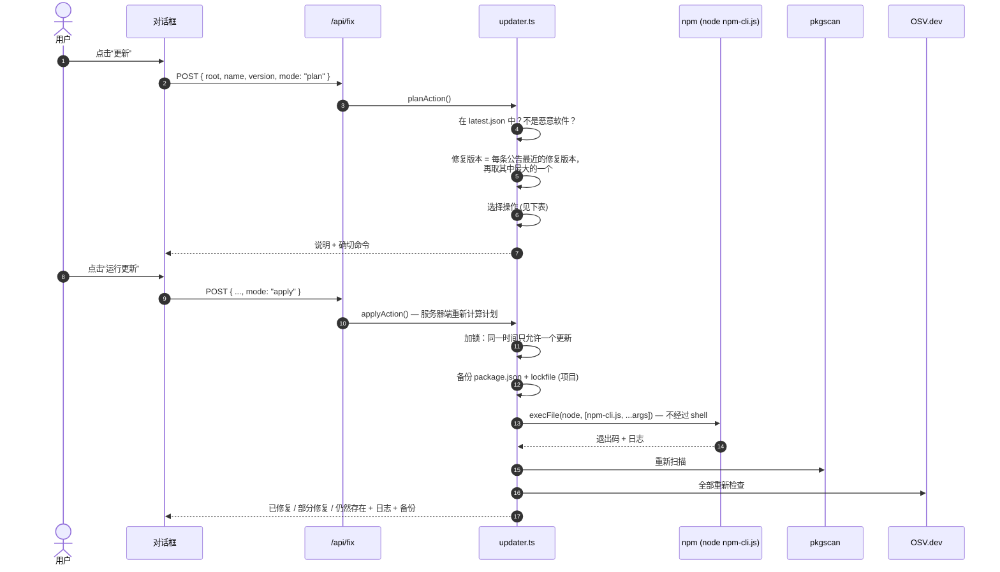

**服务器自动选择操作：**

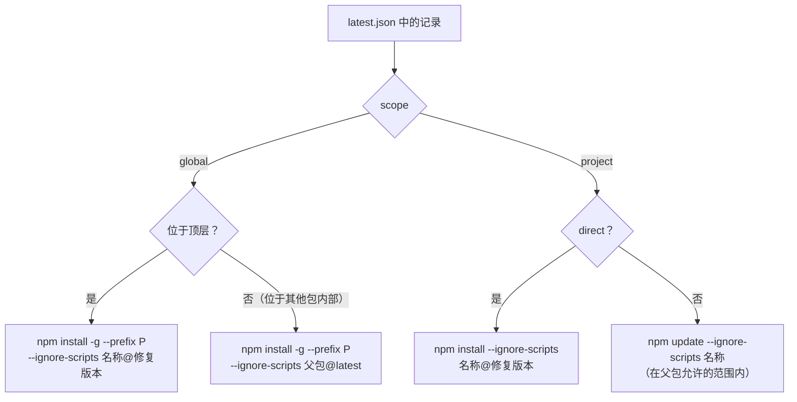

| 结果 | 含义 |
|---|---|
| ✅ **已修复** | 该目录中该包的所有安装都 ≥ 修复版本。 |
| ⚠️ **部分修复** | 部分安装已升级，部分仍是旧版本（存在多个嵌套副本）。 |
| ❌ **仍然存在** | npm 已运行完成，但父包锁定了旧版本（例如 `express@4.17.1` 锁定 `qs@6.7.0`）。需要更新父包。 |

> 修复版本选择示例：`protobufjs@7.5.4` 有修复版本 6.11.6、7.5.5 和 8.0.1。工具选择 **7.5.5**（最近的），不会跳到 8.0.1。

## 7. 规划并更新过期的包

**更新** 标签页处理所有项目的**直接依赖**和**顶层全局包**。间接依赖由父包决定，因此不在此列。

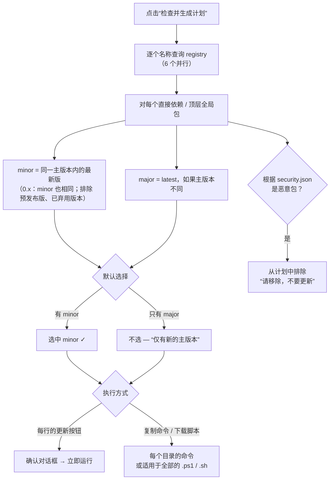

**每行的更新按钮：** 与[第 6 节](#6-一键修复漏洞)使用相同的防护措施，另外增加两项检查，因为目标版本由用户选择：

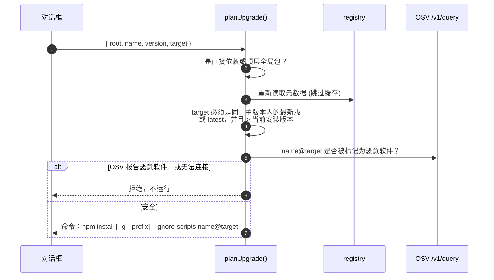

**下载的脚本**（例如 `.ps1`）：所有路径和包名都按 PowerShell / sh 的正确语法放在单引号中；某个目录出错时会继续处理其余目录，最后列出出错的目录。

```powershell
# libpack update plan - generated 2026-11-07T…
# Review before running. --ignore-scripts: package install scripts will NOT run.
$failed = @()

Write-Host '==> C:\Users\me\proj' -ForegroundColor Cyan
Push-Location -LiteralPath 'C:\Users\me\proj'
npm.cmd install --ignore-scripts 'express@4.22.3' 'lodash@4.18.1'
if ($LASTEXITCODE -ne 0) { $failed += 'C:\Users\me\proj' }
Pop-Location

if ($failed.Count) { Write-Warning ("Failed: " + ($failed -join ", ")) } else { Write-Host "Done." -ForegroundColor Green }
```

## 8. 语言与主题

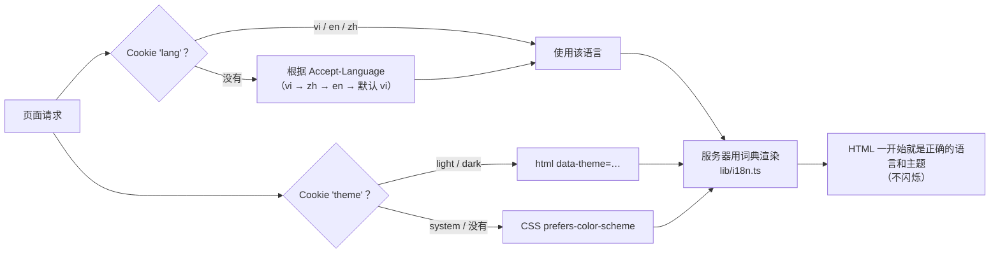

- 词典位于 `ui/src/lib/i18n.ts`。`MessageKey` 类型取自越南语版本，因此 **en 或 zh 缺少任何一个 key，TypeScript 都会在构建时立即报错**。
- API 返回的错误也会被翻译（`I18nError` → `errorMessage()`）。
- 日期和数字按 `vi-VN`、`en-US`、`zh-CN` 格式化。中文使用系统字体（Microsoft YaHei、PingFang SC、Noto Sans SC）。
